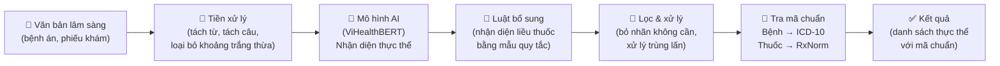

# Tổng Quan Dự Án: Hệ Thống Trích Xuất Thông Tin Y Tế từ Văn Bản Tiếng Việt

> **Đọc file này mất khoảng 8–10 phút.** Không cần biết lập trình để hiểu nội dung.

---

## Dự án này làm gì?

Khi bác sĩ viết bệnh án hoặc phiếu khám, nội dung thường ở dạng văn bản tự do, ví dụ:

> *"Bệnh nhân đau dạ dày, viêm loét hành tá tràng, chỉ định nội soi dạ dày. Kê đơn Paracetamol 500mg 2 viên/ngày."*

Hệ thống này **tự động đọc** đoạn văn bản đó và **nhận diện** các thông tin y tế quan trọng bên trong:

- **Bệnh / triệu chứng**: "đau dạ dày", "viêm loét hành tá tràng"
- **Thuốc**: "Paracetamol"
- **Bộ phận cơ thể**: "dạ dày", "hành tá tràng"
- **Thủ thuật**: "nội soi"
- **Liều lượng**: "500mg", "2 viên/ngày"

Sau khi nhận diện, hệ thống **tra mã chuẩn quốc tế** cho bệnh (mã ICD-10 của Bộ Y tế) và thuốc (mã RxNorm quốc tế), để kết quả có thể liên thông với các hệ thống y tế điện tử khác.

---

## Luồng xử lý tổng thể

Dưới đây là sơ đồ thể hiện dữ liệu đi qua hệ thống như thế nào, từ đầu vào đến kết quả cuối cùng:



**Đọc từ trái sang phải:**

1. Nhận văn bản đầu vào (tiếng Việt)
2. Chuẩn hóa văn bản: tách từng từ, tách dấu câu riêng, chia câu dài thành đoạn ngắn vừa sức xử lý của mô hình
3. Mô hình AI (đã huấn luyện sẵn trên dữ liệu y tế tiếng Việt) đọc từng từ và đánh dấu: từ này thuộc loại gì?
4. Các luật bổ sung nhận diện thêm liều thuốc mà mô hình có thể bỏ sót (ví dụ: "500mg", "2 viên/ngày")
5. Lọc bỏ các thông tin không thuộc 6 loại mục tiêu, xử lý trường hợp hai kết quả chồng lấn nhau
6. Tra bệnh ra mã ICD-10 (ví dụ: "đau bụng" → mã R10), tra thuốc ra mã RxNorm (ví dụ: "Aspirin" → mã 1191)
7. Trả về kết quả cuối cùng: danh sách thực thể kèm vị trí, độ tin cậy, và mã chuẩn (nếu có)

---

## Cấu trúc thư mục — bức tranh toàn cảnh

Dưới đây liệt kê theo đúng luồng xử lý, không theo thứ tự bảng chữ cái.

```
AI-KLTN/
│
├── ner/                    ← Bước 1-5: Nhận diện thực thể y tế
│   ├── config.py
│   ├── preprocessor.py
│   ├── predictor.py
│   ├── dosage_extractor.py
│   ├── postprocessor.py
│   ├── pipeline.py
│   ├── logger.py
│   └── __init__.py
│
├── normalization/          ← Bước 6: Tra mã chuẩn quốc tế
│   ├── base.py
│   ├── icd10.py
│   ├── rxnorm.py
│   ├── stubs.py
│   ├── dispatcher.py
│   ├── logger.py
│   ├── __init__.py
│   ├── data/               ← Dữ liệu hỗ trợ tra cứu
│   └── logs/               ← Nhật ký tra mã theo ngày
│
├── Model/                  ← Mô hình AI đã huấn luyện sẵn
│   ├── README.md
│   └── vihealthbert-ner-vietmed-v2-final/
│
├── ICD-10/                 ← Danh mục mã bệnh chính thức của Bộ Y tế
├── eval/                   ← Đánh giá hiệu năng hệ thống
│   └── results/            ← Kết quả đánh giá đã chạy
├── tests/                  ← Kiểm thử tự động
├── logs/                   ← Nhật ký hoạt động chung
│
├── run_demo_and_tests.py   ← Chạy thử nhanh
├── test_run.py             ← Chạy đánh giá đầy đủ
├── requirements.txt        ← Danh sách thư viện cần cài
├── PROJECT_CONTEXT.md      ← Tài liệu kỹ thuật nội bộ
└── PROJECT_OVERVIEW.md     ← Tài liệu bạn đang đọc
```

Các thư mục tạm như `.venv`, `__pycache__`, `.pytest_cache` và các file log chạy thử không được trình bày vì không tạo ra chức năng chính của hệ thống.

---

## Giải thích chi tiết từng phần

### 1. Thư mục `ner/` — Nhận diện thông tin y tế

Đây là phần cốt lõi của hệ thống. Nó tìm và đánh dấu các thông tin y tế trong văn bản.

| File | Làm gì? |
|:---|:---|
| `config.py` | Chứa 6 loại thực thể mục tiêu và bảng chuyển đổi từ nhãn gốc sang nhãn mục tiêu. Ví dụ: `DISEASESYMTOM` → `CONDITION`. |
| `preprocessor.py` | Chuẩn bị văn bản: tách từ, tách dấu câu và chia câu dài thành đoạn ngắn. Ví dụ, dấu phẩy sau “dạ dày,” không bị dính vào tên thực thể. |
| `predictor.py` | Nạp ViHealthBERT và dự đoán mỗi từ thuộc loại gì. Ví dụ, “đau” có thể được nhận diện là triệu chứng, còn “dạ dày” là bộ phận cơ thể. |
| `dosage_extractor.py` | Nhận diện cụm liều thuốc bằng quy tắc. Ví dụ, “500mg 2 viên/ngày” được tách thành giá trị, đơn vị và tần suất. |
| `postprocessor.py` | Lọc kết quả, bỏ các từ như “chỉ định” bị nhận nhầm là thuốc, gộp “sốt” + “cao” thành “sốt cao”, và chọn kết quả đáng tin cậy hơn khi bị chồng lấn. |
| `pipeline.py` | Cửa chính nối tất cả bước nhận diện và tra mã. Người dùng đưa văn bản vào đây để nhận kết quả cuối. |
| `logger.py` | Ghi nhật ký từng bước, giúp biết hệ thống đã xử lý văn bản ra sao. |
| `__init__.py` | File kết nối kỹ thuật để các phần khác sử dụng được `ner/`. |

### 2. Thư mục `normalization/` — Tra mã chuẩn

Sau khi biết một cụm từ là bệnh hay thuốc, phần này tìm mã chuẩn tương ứng.

| File | Làm gì? |
|:---|:---|
| `base.py` | Quy định cấu trúc chung của một kết quả tra mã: hệ mã, mã số, tên chuẩn và độ tin cậy. |
| `icd10.py` | Tra mã ICD-10 cho bệnh và triệu chứng. Ví dụ: “viêm phổi” → J18, “tiểu đường” → E14. Có tra chính xác, tra đồng nghĩa và so khớp gần đúng an toàn. |
| `rxnorm.py` | Tra mã RxNorm cho thuốc qua dịch vụ RxNav. Ví dụ: “Aspirin” → mã RxCUI 1191. Kết quả được lưu lại để lần sau tra nhanh hơn. |
| `stubs.py` | Các khung chờ cho tra mã bộ phận cơ thể, xét nghiệm và thủ thuật. Hiện tại chưa trả mã. |
| `dispatcher.py` | Điều phối: CONDITION được gửi tới ICD-10, DRUG được gửi tới RxNorm, còn các loại chưa làm được chuyển tới phần khung chờ. |
| `logger.py` | Ghi lại việc tra mã thành công, thất bại, thời gian xử lý và các thuốc chưa tìm thấy. |
| `__init__.py` | File kết nối kỹ thuật để các phần khác sử dụng được `normalization/`. |

**`normalization/data/` chứa dữ liệu hỗ trợ:**

- `icd10_cache.pkl`: bản lưu nhanh danh mục ICD-10 đã đọc.
- `icd10_synonyms.json`: từ điển đồng nghĩa, ví dụ “nhức đầu” và “đau đầu”.
- `rxnorm_cache.db`: bộ nhớ lưu kết quả tra thuốc.
- `unmatched_drugs.log`: danh sách tên thuốc chưa tra được mã để nhóm xem xét.

**`normalization/logs/`** chứa nhật ký tra mã theo từng ngày.

### 3. `Model/` — Mô hình AI đã huấn luyện sẵn

Đây là “bộ não” của hệ thống: mô hình ViHealthBERT đã học từ bộ dữ liệu y tế tiếng Việt VietMed-NER để nhận diện thực thể.

Trọng số chính `model.safetensors` có dung lượng khoảng **512,86 MB**, vượt giới hạn file thông thường của GitHub nên không được lưu trong git. Muốn chạy hệ thống, cần tải trọng số từ kho lưu trữ của nhóm và đặt đúng vào:

`Model/vihealthbert-ner-vietmed-v2-final/model.safetensors`

Các bước tải và các file phụ trợ được mô tả trong `Model/README.md`.

### 4. `ICD-10/` — Danh mục mã bệnh

Đây là danh mục mã bệnh chính thức của Bộ Y tế Việt Nam, dùng để tra cứu bệnh và triệu chứng. Ví dụ: R10 là đau bụng và vùng chậu, J18 là viêm phổi.

- `phu-lu-c-1-danh-mu-c-icd-10-thay-the-dmdc-phie-n-ba-n-6.xlsx`: bảng tra cứu ICD-10 dạng Excel.
- `06-byt-kem.pdf`: tài liệu PDF kèm theo danh mục của Bộ Y tế.


### 5. `eval/` — Đánh giá hiệu năng

Thư mục này kiểm tra hệ thống trên **3.497 câu** thuộc phần `test` của bộ dữ liệu VietMed-NER, tách riêng với dữ liệu dùng để huấn luyện.

| File | Làm gì? |
|:---|:---|
| `data_loader.py` | Tải dữ liệu kiểm tra và chuẩn bị đáp án đúng để so sánh. |
| `evaluate_tier1.py` | Đo riêng mô hình gốc với 37 nhãn ban đầu. |
| `evaluate_tier2.py` | Đo toàn bộ quy trình với 6 nhãn mục tiêu. Đây là kết quả gần với việc sử dụng thực tế. |
| `metrics.py` | Tính các chỉ số đúng, bỏ sót, nhận nhầm, F1, ma trận nhầm lẫn và tìm các câu lỗi nhiều. |
| `run_eval.py` | Chạy các bước đánh giá và tạo báo cáo tổng hợp. |

`eval/results/` chứa các kết quả đã tạo: `summary.md` là báo cáo dễ đọc; các file `raw_37label_report` và `schema_6label_report` là báo cáo chi tiết; `confusion_matrix.png` là hình minh họa lỗi; `top_error_cases.json` là 20 câu lỗi nhiều nhất; `latency_report.json` là báo cáo tốc độ.

### 6. `tests/` — Kiểm thử tự động

- `test_ner_pipeline.py`: kiểm tra tách từ, dấu câu, ánh xạ 6 nhãn, liều “500mg 2 viên/ngày”, câu rỗng, câu không y tế và văn bản dài.
- `test_normalization.py`: kiểm tra “đau bụng” ra R10 chứ không nhầm thành “đau lưng”, thuốc Aspirin ra RxNorm, bộ nhớ đệm và các loại chưa có mã.
- `test_end_to_end_pipeline.py`: đưa văn bản qua toàn bộ hệ thống, kiểm tra nhận diện, tra mã, liều lượng và khả năng bật/tắt tra mã.

### 7. Các file quan trọng ở thư mục gốc

- `run_demo_and_tests.py`: demo chính với 7 tình huống, gồm câu nhiều thực thể, dấu câu, liều thuốc, câu rỗng, câu không y tế và câu dài.
- `test_run.py`: chạy đánh giá đầy đủ trên bộ dữ liệu kiểm tra.
- `requirements.txt`: danh sách thư viện cần cài.
- `PROJECT_CONTEXT.md`: tài liệu kỹ thuật dành cho người phát triển tiếp, không phải tài liệu giới thiệu.
- `.gitignore`: quy định file tạm, log và file lớn nào không cần lưu vào git.

---

## Các quyết định thiết kế quan trọng

### Vì sao chỉ nhận diện 6 loại thông tin?

Mô hình gốc biết 37 loại nhãn, gồm cả tuổi, giới tính, ngày tháng, nghề nghiệp và địa điểm. Đề tài tập trung vào thông tin trực tiếp phục vụ chẩn đoán và điều trị nên chỉ giữ lại:

- **CONDITION** — bệnh hoặc triệu chứng, như “viêm phổi”, “đau đầu”.
- **DRUG** — thuốc, như “Paracetamol”.
- **BODY_PART** — bộ phận cơ thể, như “phổi”, “dạ dày”.
- **TEST** — xét nghiệm, như “điện tâm đồ”.
- **PROCEDURE** — thủ thuật, như “nội soi”, “đặt stent”.
- **DOSAGE** — liều lượng, như “500mg”, “2 viên/ngày”.

Các loại còn lại bị loại khỏi kết quả vì không thuộc trọng tâm hiện tại. Cách này giúp đầu ra gọn hơn và phù hợp với mục tiêu của khóa luận.

### Vì sao chỉ 2/6 loại được tra mã chuẩn?

- **CONDITION → ICD-10**: đã có danh mục mã bệnh chính thức của Bộ Y tế trong thư mục `ICD-10/`.
- **DRUG → RxNorm**: đã có dịch vụ tra cứu tên thuốc quốc tế.

**BODY_PART, TEST và PROCEDURE chưa được tra mã** vì hiện còn thiếu nguồn dữ liệu tiếng Việt phù hợp và nằm ngoài phạm vi ưu tiên của giai đoạn hiện tại. `stubs.py` đã chuẩn bị khung để bổ sung sau. **DOSAGE không tra mã** vì nó được giữ dưới dạng thông tin có cấu trúc — giá trị, đơn vị và tần suất — chứ không phải một khái niệm bệnh hay thuốc.

---

## Muốn thử nhanh thì làm gì?

Cần có Python, các thư viện trong `requirements.txt` và trọng số mô hình theo hướng dẫn `Model/README.md`.

```text
pip install -r requirements.txt
python run_demo_and_tests.py
```

Lệnh demo sẽ in kết quả của các câu mẫu ra màn hình và ghi lại vào `test_run_output.txt`. Không cần hiểu mã nguồn để xem kết quả. Nếu cần chạy đánh giá đầy đủ, dùng `python test_run.py`; bước này lâu hơn vì xử lý toàn bộ bộ dữ liệu kiểm tra.

---

## Tình trạng hiện tại

### Đã hoàn thành

- Hệ thống nhận diện đủ 6 loại thực thể và có xử lý câu rỗng, dấu câu, liều thuốc và văn bản dài.
- Đã đánh giá trên 3.497 câu VietMed-NER:
  - Khớp chính xác cả loại và vị trí: **Micro F1 = 0,6223**, tức khoảng 62%.
  - Chấp nhận vị trí có chồng lấn nhưng đúng loại: **Micro F1 = 0,7536**, tức khoảng 75%.
- Tra mã CONDITION → ICD-10 và DRUG → RxNorm đã triển khai.
- Bộ kiểm thử tự động cho NER, tra mã và toàn bộ luồng đã có.
- Tốc độ trung bình trong báo cáo: khoảng **120 mili-giây/câu**.

### Chưa thực hiện

- **Relation Extraction**: chưa xác định quan hệ giữa các thực thể, ví dụ “Paracetamol điều trị đau đầu” hoặc “đau nằm ở dạ dày”.
- **BODY_PART normalization**: chưa tra mã FMA.
- **TEST normalization**: chưa tra mã LOINC.
- **PROCEDURE normalization**: chưa tra mã MeSH.

---

## Hai điểm cần đọc thận trọng

1. “F1” trong phần tình trạng là một cách đo chất lượng nhận diện; con số khoảng 62% và 75% được lấy từ báo cáo đánh giá có sẵn, không có nghĩa là mọi câu đều đúng hoặc sai theo cùng một mức.
2. RxNorm là dịch vụ tra cứu trực tuyến, nên kết quả tra thuốc có thể phụ thuộc vào kết nối mạng; hệ thống có bộ nhớ lưu kết quả đã tra để giảm ảnh hưởng này.

*Tài liệu này dành cho người chưa từng biết dự án. Thông tin kỹ thuật sâu hơn nằm trong `PROJECT_CONTEXT.md`.*

