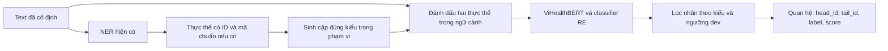

# Kế hoạch Relation Extraction cho khóa luận — 3 tuần

Ngày lập: 28/09/2026. Thời lượng: 21 ngày; nếu bắt đầu ngay, kết thúc ngày 18/10/2026.

Đây là đề xuất nghiên cứu và triển khai, chưa phải kết quả thực nghiệm. Quy mô dữ liệu, cấu hình huấn luyện, baseline và metric bên dưới là phương án để người làm khóa luận chốt với GVHD; không thay đổi schema đang có trong dự án.

## 1. Mục tiêu và phạm vi

Hoàn thành một bộ dữ liệu quan hệ có kiểm duyệt, một baseline bằng luật, một mô hình RE có giám sát, đánh giá độc lập RE và toàn bộ pipeline, cùng phần báo cáo khóa luận.

Phương án chính: dùng văn bản và thực thể của VietMed-NER, kiểm tra/chỉnh thực thể rồi bổ sung nhãn quan hệ; huấn luyện mô hình phân loại cặp dùng ViHealthBERT với dấu đánh dấu thực thể. NER đang có tiếp tục được dùng để suy luận. Mô hình RE là checkpoint riêng, không ghi đè hoặc huấn luyện lại NER.

Giả định nguồn lực để lập lịch: một người thực hiện khoảng 4–5 giờ/ngày trong 21 ngày, có một GPU dùng được cho mô hình cỡ BERT-base; cố gắng có người thứ hai kiểm tra một phần nhãn. Chưa có thông tin xác nhận về GPU và người kiểm duyệt. Nếu chỉ làm 1–2 giờ/ngày, dùng phương án giảm tải ở mục 10.

Phạm vi đầu tiên: quan hệ có bằng chứng trực tiếp trong cùng câu hoặc cùng đoạn phát ngôn ngắn. VietMed là dữ liệu lời nói: một hàng dữ liệu không nhất thiết là một câu có dấu câu hoàn chỉnh. Giữ ranh giới phát ngôn và nguồn hội thoại; không tự ghép các hàng chỉ vì chúng đứng cạnh nhau trong file.

Quan hệ qua nhiều câu, đồng tham chiếu, joint NER–RE và xây dựng knowledge graph lớn để ở hướng phát triển. Ghi nhận số trường hợp ngoài phạm vi để báo cáo mức bao phủ.

## 2. Xuất phát điểm trong repository

- `ner/pipeline.py`: `MedicalNERPipeline.predict()` trả `text` và `entities` với `surface_text`, `label`, `start_char`, `end_char`, `confidence`, có thể có `normalized`.
- `ner/config.py`: 6 loại thực thể; VietMed có 37 nhãn BIO, tương ứng 18 loại thực thể gốc và nhãn O, không phải 37 loại thực thể.
- `re_labels.json` và `docs/RE_LABELS.md`: 5 quan hệ có chiều; `NO_RELATION` là nhãn âm, không phải quan hệ y khoa thứ sáu.
- `eval/results/summary.md`: báo cáo có sẵn ghi strict NER micro-F1 = 0,6223, relaxed = 0,7536; DOSAGE strict F1 = 0,4370, PROCEDURE = 0,5077. Đây là kết quả đã lưu, chưa chạy lại trong lần lập kế hoạch này.
- `ner/postprocessor.py`: giải quyết chồng lấn bằng cách giữ span có confidence cao hơn. RE không thể khôi phục quan hệ nếu một đầu mút đã bị NER loại.
- Checkpoint NER dùng kiến trúc RoBERTa, hidden size 768 và `max_position_embeddings=258`; không mặc định RE có thể nhận 512 token. Phải đọc cấu hình của checkpoint RE thực sự chọn.

## 3. Bộ dữ liệu: nguồn nào phù hợp?

### 3.1. Kết luận khảo sát

Trong các nguồn đã kiểm tra ngày 28/09/2026, chưa xác nhận được bộ RE tiếng Việt công khai, có nhãn quan hệ được kiểm duyệt ở mức span, khớp đầy đủ 5 quan hệ của dự án và có thể dùng trực tiếp. Điều này không chứng minh rằng không tồn tại bộ dữ liệu như vậy.

**VietMed-NER — nguồn chính.** Dữ liệu tiếng Việt trong miền y tế, có transcript và nhãn thực thể, công bố cho bài toán spoken NER. Có thể tái sử dụng thực thể và bổ sung quan hệ, nhưng không được coi nhãn NER là nhãn RE. Đây là lời nói/hội thoại y tế, không mặc nhiên đại diện cho bệnh án bệnh viện. Nguồn: [dataset của tác giả](https://huggingface.co/datasets/leduckhai/VietMed-NER), [bài báo](https://arxiv.org/abs/2406.13337).

**ViMQ — nguồn bổ sung.** Repository của tác giả cung cấp dữ liệu câu hỏi y tế cho intent classification và NER. Có thể tìm văn bản bổ sung, nhưng vẫn phải map thực thể và đánh quan hệ mới; câu hỏi chưa khẳng định cách điều trị không tự trở thành quan hệ dương. Nguồn: [ViMQ](https://github.com/tadeephuy/ViMQ).

**ViMedGraph — cần thẩm định trước khi dùng.** Dataset card công bố 1.932 tài liệu và 106.666 quan hệ trong tài nguyên GraphRAG tiếng Việt. Card đã xem chưa đủ để xác nhận có gold RE gồm span offsets, bằng chứng cho từng cặp, người đánh nhãn và split phù hợp. Suy luận cho dự án: có thể khảo sát nguồn văn bản/nhãn gợi ý, chưa đưa các cạnh graph vào gold test. Nguồn: [ViMedGraph](https://huggingface.co/datasets/vuduylinh150804/vietmed-rag-dataset).

**i2b2/n2c2 2010 — tham khảo bài toán lâm sàng.** Quan hệ giữa problem, treatment, test gần với một phần schema. Cần kiểm tra từng subtype: quan hệ điều trị bệnh khác quan hệ gây bệnh, xét nghiệm được thực hiện khác xét nghiệm xác nhận bệnh. Treatment cũng không tự phân biệt DRUG và PROCEDURE theo schema hiện tại. Tiếng Anh và cần quy trình truy cập dữ liệu. Nguồn: [đơn vị tổ chức](https://n2c2.dbmi.hms.harvard.edu/2010-challenge), [cổng dữ liệu](https://portal.dbmi.hms.harvard.edu/).

**n2c2 2018 Track 2 — tham khảo liên kết thuốc.** Có bài toán nối thuốc với thuộc tính và biến cố bất lợi; hữu ích khi thiết kế `has_dosage` và phân biệt chỉ định với tác dụng phụ. Bộ này phân biệt các thuộc tính thuốc chi tiết hơn DOSAGE của dự án, nên cần kiểm tra span/ý nghĩa trước khi map. Là dữ liệu tiếng Anh, truy cập theo quy định của đơn vị phát hành. Nguồn: [thông báo chính thức từ ban tổ chức](https://www.aclweb.org/portal/node/3330), [cổng dữ liệu](https://portal.dbmi.hms.harvard.edu/).

**BC5CDR — không dùng làm dữ liệu trực tiếp cho `treated_by`.** Có 1.500 bài PubMed; quan hệ mục tiêu là chemical-induced disease. Quan hệ “thuốc gây bệnh” không được đảo chiều rồi biến thành “bệnh được điều trị bằng thuốc”. Nguồn: [bài báo xây dựng corpus](https://pmc.ncbi.nlm.nih.gov/articles/PMC4860626/).

**CMeIE/CBLUE — tham khảo schema và cách tổ chức dữ liệu.** Là dữ liệu trích xuất thông tin y tế tiếng Trung. Dịch và căn chỉnh lại thực thể/quan hệ tạo thêm công việc, nên không đưa vào đường triển khai chính trong 3 tuần. Nguồn: [repository chính thức CBLUE](https://github.com/CBLUEbenchmark/CBLUE).

Chỉ dành tối đa nửa ngày đầu để xác minh nguồn tải, cấu trúc, điều kiện sử dụng và khả năng khớp nhãn. Giấy phép mã nguồn không tự áp dụng cho dữ liệu; dataset card thiếu điều khoản thì cần xác minh trước khi phát hành lại văn bản. Không để tiến độ phụ thuộc vào việc chờ quyền truy cập dữ liệu quốc tế.

### 3.2. Cách quyết định dùng dữ liệu có sẵn

Một nguồn chỉ thay thế được việc đánh nhãn mới nếu có đủ: văn bản tiếng Việt; vị trí hai thực thể; loại và chiều quan hệ; bằng chứng trong văn bản; quy trình kiểm duyệt; quyền sử dụng; khả năng tách nguồn giữa train/dev/test. Nếu chỉ khớp một vài quan hệ, dùng phần tương thích và tự đánh phần còn thiếu, ghi rõ xuất xứ từng mẫu.

## 4. Schema quan hệ và quy tắc đánh nhãn

| Quan hệ | Chiều cố định | Bằng chứng tối thiểu | Ví dụ minh họa tự soạn |
|---|---|---|---|
| `located_at` | CONDITION → BODY_PART | Văn bản nói tình trạng nằm ở bộ phận đó | “Khối u nằm ở gan.” |
| `treated_by` | CONDITION → DRUG | Thuốc được nêu để điều trị tình trạng | “Đau đầu được điều trị bằng Paracetamol.” |
| `treated_by_procedure` | CONDITION → PROCEDURE | Thủ thuật được nêu để điều trị tình trạng | “Hẹp động mạch vành được điều trị bằng đặt stent.” |
| `diagnosed_by` | CONDITION → TEST | Phương pháp được nêu để xác định/chẩn đoán tình trạng | “Viêm phổi được xác nhận bằng chụp X-quang.” |
| `has_dosage` | DRUG → DOSAGE | Cụm liều thực sự thuộc thuốc đó | “Paracetamol 500 mg.” |

Các ví dụ chỉ minh họa ngôn ngữ cho gán nhãn, không phải dữ liệu đã thu thập hay hướng dẫn điều trị.

Quy tắc bắt buộc theo schema hiện tại:

1. Chỉ sinh cặp đúng loại head/tail. BODY_PART → DRUG nằm ngoài phạm vi, không dùng như mẫu âm dễ.
2. Nhãn dương phải có bằng chứng nối chính hai mention. Cùng xuất hiện hoặc cùng mã chuẩn không đủ.
3. Giữ chiều ngữ nghĩa, không phụ thuộc thực thể nào xuất hiện trước trong câu.
4. Một thực thể có thể tham gia nhiều quan hệ; một thuốc có thể có nhiều cụm DOSAGE. Không áp đặt mỗi thực thể chỉ được nối một lần.
5. Chỉ sinh `NO_RELATION` khi cặp đã được kiểm tra, hoặc cả đơn vị văn bản được đánh nhãn đầy đủ và đánh dấu hoàn tất. Cặp chưa kiểm tra không phải nhãn âm.
6. Trường hợp không xác định được phải có trạng thái `needs_review`; trạng thái này là metadata, không thêm vào 5 nhãn quan hệ. Không đưa cặp chưa giải quyết vào loss hoặc điểm số; công bố số lượng bị loại. Một đơn vị chỉ `complete` sau khi mọi cặp trong phạm vi đã có quyết định.
7. Giữ nguyên tên, liều và đơn vị như trong văn bản. Không tự tạo BODY_PART từ kiến thức về tên bệnh hoặc dùng ontology để suy ra quan hệ.

Những tình huống cần người làm khóa luận/GVHD chốt trong ngày 1–2, kèm đề xuất ban đầu:

- Phủ định như “không dùng thuốc X để điều trị Y”: đề xuất không gán quan hệ điều trị khẳng định; lưu lý do khi đánh âm.
- Câu hỏi/giả định như “X có trị Y không?”: đề xuất không gán dương khi văn bản chưa khẳng định.
- Kế hoạch như “chỉ định X để điều trị Y”: đề xuất tính là liên kết điều trị được nêu, không suy diễn bệnh nhân đã dùng hay đã khỏi. Nhãn hiện tại không biểu diễn thời điểm/trạng thái điều trị.
- `diagnosed_by`: đề xuất nhận bằng chứng xác nhận hoặc nêu rõ mục đích chẩn đoán; không nhận mọi xét nghiệm tình cờ xuất hiện cạnh bệnh.
- “Aspirin gây đau dạ dày”: không phải `treated_by`; nếu thuộc phạm vi cặp CONDITION–DRUG đã kiểm tra thì là mẫu âm khó cho quan hệ đó.
- DOSAGE: `UNITCALIBRATOR` gốc có thể là đại lượng không phải liều thuốc. Rà soát theo nghĩa DOSAGE của dự án, không map mọi con số/đơn vị thành liều thuốc.
- Thực thể lồng nhau: “viêm phổi” không bảo đảm NER cũng trả BODY_PART “phổi”. Đề xuất giữ benchmark chính phù hợp biểu diễn NER phẳng; ghi trường hợp lồng nhau vào danh sách ngoài phạm vi. Nếu muốn đánh giá nested RE thì phải chốt quy tắc span riêng và thay đổi NER, vượt phạm vi chính 3 tuần.

Không âm thầm bỏ ca khó khỏi test mà không báo cáo tiêu chí loại và số lượng.

## 5. Kế hoạch xây dựng dữ liệu từ phần NER

### 5.1. Quy mô làm việc

Mục tiêu ban đầu: **600 đơn vị văn bản đã kiểm duyệt**, dự kiến 400 train / 100 dev / 100 test. Đây là ngân sách làm việc, không phải số liệu đã thống kê hoặc bảo đảm đủ 5 nhãn. Nếu split chính thức/nhóm nguồn không cho phép đúng tỷ lệ này, ưu tiên chống rò rỉ dữ liệu và công bố số thực tế.

Không đặt số cặp bằng số câu: một đoạn có thể sinh nhiều cặp hoặc không có cặp. Sau pilot mới tính tổng cặp, số quan hệ dương và mật độ theo từng nhãn.

Mục tiêu phủ nhãn để định hướng lấy mẫu: cố gắng có ít nhất khoảng 60 quan hệ dương/nhãn ở train và 15–20 ở mỗi dev/test. Đây chỉ là mức tối thiểu thăm dò; test nhỏ như vậy có độ bất định lớn. Không tạo nhãn giả hoặc chuyển dữ liệu test sang train để đạt chỉ tiêu. Nếu không đạt, báo cáo nhãn hiếm riêng, không tuyên bố mô hình đã giải quyết tốt toàn bộ 5 quan hệ.

Ước lượng công sức: 600 đơn vị × 2–4 phút đọc/sửa/nối quan hệ = 20–40 giờ cho một lượt. Dự trù thêm 6–10 giờ thiết lập, pilot và rà soát; 4–6 giờ người thứ hai nếu có. Đo tốc độ thực tế trên 50–80 mẫu đầu rồi điều chỉnh ngân sách trước khi gán nhãn đại trà.

### 5.2. Quy trình 8 bước

**Bước 1 — Kiểm kê nguồn và giữ split.** Lưu `source`, `source_id`, `group_id`, `source_split`, phiên bản dataset. Với VietMed, ưu tiên train nguồn → RE train, validation nguồn → RE dev, test nguồn → RE test. Nếu có ID hội thoại/recording thì nhóm theo nguồn; kiểm tra trùng/gần trùng xuyên split. Không chia ngẫu nhiên các cặp từ cùng một câu vào ba tập.

NER đã huấn luyện trên VietMed: không chia lại toàn bộ corpus rồi tuyên bố test RE là test end-to-end chưa từng thấy. Cần xác minh lịch sử checkpoint, dữ liệu tuning và các rule hậu xử lý; test NER đã được xem để điều chỉnh thì phải công bố hoặc bổ sung test mới. Nếu không có metadata đủ mạnh, báo cáo rõ giới hạn của phép kiểm tra độc lập theo nguồn.

**Bước 2 — Cố định text và tọa độ.** Lưu `raw_text` cùng `text` dùng gán nhãn. NER hiện trả tọa độ trên text sau chuẩn hóa khoảng trắng; annotation và RE phải dùng chính text đó. Không thay text sau khi gán span. Dùng `end_char` theo quy ước exclusive; kiểm tra `text[start_char:end_char] == surface_text`. Khi nhập/xuất công cụ đánh nhãn, kiểm tra round-trip Unicode, dấu tiếng Việt và ký tự ngoài BMP nếu xuất hiện.

**Bước 3 — Chuẩn bị thực thể.** Với VietMed-NER, ưu tiên annotation NER gốc đã map sang 6 nhãn để làm điểm xuất phát, sau đó người đọc rà soát. Với văn bản mới, chạy checkpoint NER để pre-annotate. Sửa span, sửa loại, xóa nhận nhầm và thêm thực thể bị bỏ sót trước khi nối quan hệ. Lưu riêng `entities_pred` và `entities_gold`; không tự coi dự đoán NER là gold.

**Bước 4 — Pilot 80 mẫu trong train.** Gồm mẫu ngẫu nhiên để ước lượng phân bố và mẫu có các cặp hiếm để thử guideline. Thống kê: thời gian/mẫu, số cặp đúng kiểu, số quan hệ dương theo nhãn, ca mơ hồ, ca lồng nhau, ca cần ngữ cảnh ngoài đoạn. Chốt phạm vi dựa trên pilot, không sửa quy tắc theo kết quả test.

**Bước 5 — Dùng công cụ có sẵn.** Dùng Label Studio: nhập text và thực thể, người gán nhãn sửa span rồi kéo liên kết head → tail. Export về JSONL của dự án. Template chính thức hỗ trợ label spans và relation arrows: [Label Studio Relation Extraction](https://labelstud.io/templates/relation_extraction). Không xây một web app đánh nhãn mới trong lịch 3 tuần.

**Bước 6 — Lấy mẫu và đánh nhãn.** Train có thể ưu tiên đoạn nhiều thuốc/liều, nhiều bệnh/thủ thuật, và cặp khó. Dành khoảng 30% train lấy ngẫu nhiên để giảm lệ thuộc từ khóa; tỷ lệ này là điểm khởi đầu. Dev/test lấy theo quy trình đã khóa, không chọn mẫu vì mô hình dự đoán đúng. Nếu cố ý cân bằng dev/test để đủ lớp thì phải ghi rõ là benchmark đã lấy mẫu phân tầng, không diễn giải precision như trên phân bố sử dụng tự nhiên.

**Bước 7 — Kiểm tra chất lượng.** Nếu có người thứ hai, gán độc lập 20% dữ liệu, ưu tiên có cả 5 nhãn; hòa giải mọi bất đồng trong phần này. Đo agreement trước hòa giải trên cùng tập cặp: Cohen's kappa cho nhãn và positive relation F1 giữa hai người; đọc cả support vì nhiều NO_RELATION có thể làm agreement tổng thể cao. Có thể dùng mốc kappa 0,75 và positive agreement F1 0,80 làm tín hiệu nội bộ để rà guideline, không phải chuẩn bảo đảm chất lượng y khoa. Người thứ hai kiểm tra toàn bộ ca mơ hồ và rà test nếu thời gian cho phép.

Nếu chỉ có một người, kiểm tra lại 15–20% sau ít nhất 48 giờ, giấu nhãn lần đầu. Báo cáo đó là độ nhất quán của một người, không phải inter-annotator agreement và không gọi là chuyên gia xác nhận.

**Bước 8 — Khóa phiên bản dữ liệu.** Chốt train/dev/test, guideline version, danh sách nguồn và checksum. Lưu toàn bộ cặp âm đã xác nhận của dev/test. Test không dùng chọn luật, threshold, prompt, epoch hoặc siêu tham số. Nếu phát hiện lỗi nhãn test sau cùng, ghi sửa lỗi và đánh giá lại tất cả hệ thống theo cùng phiên bản.

### 5.3. Có dùng LLM hỗ trợ không?

Có thể dùng để gợi ý trên train khi thực sự tiết kiệm thời gian: đầu vào gồm text, entity IDs, 5 quy tắc và cặp hợp lệ; đầu ra chỉ gồm head_id, tail_id, label, trích đoạn bằng chứng. Validator kiểm tra ID, kiểu và bằng chứng phải tồn tại trong text; người đọc quyết định nhãn cuối. Giữ provenance `llm_suggested`/`human_verified`.

Không đưa dự đoán chưa duyệt vào gold; không dùng cùng LLM vừa tạo đáp án vừa làm trọng tài đánh giá. Dev/test ưu tiên đọc độc lập, giấu gợi ý quan hệ để giảm thiên lệch. Dữ liệu tổng hợp nếu thử chỉ thuộc train và phải có thí nghiệm tách riêng; không cần cho kế hoạch chính.

### 5.4. Định dạng dữ liệu tối thiểu

Ví dụ tự soạn, không thuộc VietMed:

```json
{
  "id": "example_001",
  "source": "illustrative_only",
  "group_id": "example_group_001",
  "split": "train",
  "text": "Đau đầu được điều trị bằng Paracetamol 500 mg.",
  "entities": [
    {"id": "e1", "surface_text": "Đau đầu", "label": "CONDITION", "start_char": 0, "end_char": 7},
    {"id": "e2", "surface_text": "Paracetamol", "label": "DRUG", "start_char": 27, "end_char": 38},
    {"id": "e3", "surface_text": "500 mg", "label": "DOSAGE", "start_char": 39, "end_char": 45}
  ],
  "relations": [
    {"head_id": "e1", "tail_id": "e2", "label": "treated_by"},
    {"head_id": "e2", "tail_id": "e3", "label": "has_dosage"}
  ],
  "annotation_status": "complete",
  "guideline_version": "1.0"
}
```

File gốc lưu thực thể và cạnh dương cùng trạng thái duyệt. File huấn luyện sinh một hàng/cặp ứng viên; chỉ suy ra các cạnh âm từ bản ghi `complete`. Lưu thêm evidence, người gán nhãn, ngày duyệt và lý do loại ở metadata thực tế.

## 6. Thiết kế kỹ thuật

### 6.1. Luồng dữ liệu



Training RE dùng thực thể gold; inference end-to-end dùng thực thể NER. Chuẩn hóa ICD-10/RxNorm là metadata đính kèm; baseline RE không yêu cầu tra mã thành công và không suy luận quan hệ từ mã. Cache NER trên split đánh giá để các mô hình RE nhận đầu vào giống nhau.

### 6.2. Sinh cặp

Với mỗi đơn vị văn bản, lấy tích các tập entity theo đúng 5 kiểu cặp. Không tạo self-pair; ID phân biệt từng mention, kể cả khi hai mention cùng surface hoặc cùng mã. Loại cặp trùng, giữ chiều schema. Không giới hạn theo khoảng cách quá sớm; đo recall của bộ sinh cặp trước khi thêm bộ lọc.

Vì 5 kiểu cặp trong schema đều khác nhau, **kiểu head/tail đã quyết định quan hệ dương có thể có**. Ví dụ CONDITION–DRUG chỉ có `treated_by` hoặc `NO_RELATION`. Mô hình vẫn phải đọc ngữ cảnh để quyết định có cạnh hay không; không thể lấy loại thực thể làm đáp án dương.

Đề xuất dùng chung classifier 6 đầu ra, gồm 5 nhãn dương và NO_RELATION, mask 4 nhãn dương không hợp lệ cho từng cặp trước softmax ở cả train và inference. Về quyết định, mỗi cặp là bài toán nhị phân có điều kiện theo kiểu. Cách khác là một đầu ra sigmoid dùng chung với thông tin kiểu; không cần xây cả hai trong 3 tuần.

### 6.3. Các phương án so sánh

**B0 — baseline bằng luật.** Dùng trigger và cấu trúc ngắn: “điều trị bằng”, “xác nhận bằng”, “nằm ở”; nối thuốc–liều khi cấu trúc cục bộ rõ ràng, có kiểm tra thuốc chen giữa và phạm vi phủ định. Luật chỉ được phát triển trên train/dev. Ghi riêng lỗi khi nối thực thể gần nhất không đúng và lỗi không có trigger.

**B1 — phương án chính: ViHealthBERT + typed entity markers.** Tạo input riêng cho từng cặp; ví dụ:

```text
[H_CONDITION] Đau đầu [/H_CONDITION] được điều trị bằng
[T_DRUG] Paracetamol [/T_DRUG] 500 mg.
```

Giữ phần văn bản quanh hai thực thể. Đăng ký các marker thành special tokens, resize token embeddings. Lấy hidden states tại marker đầu của head và tail, nối thành vector 2d, qua dropout và linear classifier. Với d=768, vector cặp có 1.536 chiều. Dùng cross-entropy trên logits đã mask. Ý tưởng pipeline và typed markers tham khảo [PURE — A Frustratingly Easy Approach for Entity and Relation Extraction](https://aclanthology.org/2021.naacl-main.5/); kết quả của PURE không phải kết quả dự kiến của dự án này.

Encoder khởi tạo từ [ViHealthBERT base syllable](https://huggingface.co/demdecuong/vihealthbert-base-syllable), theo mô hình miền y tế tiếng Việt của [bài báo ViHealthBERT](https://aclanthology.org/2022.lrec-1.35/). Đây là huấn luyện một mô hình RE mới khi triển khai kế hoạch; checkpoint token classification NER không tự trở thành classifier quan hệ.

**B2 — ablation nhỏ, nếu kịp.** Cùng encoder, thay typed markers bằng marker chỉ vai trò head/tail; giữ cùng dữ liệu, bộ sinh cặp và cách mask. So với B1 để kiểm tra đóng góp của thông tin kiểu trong biểu diễn. Nếu thêm một encoder PhoBERT/XLM-R, bỏ B2 để tránh tăng số thí nghiệm; không cần làm cả hai.

Joint NER–RE và mô hình sinh triples bằng LLM có thể nêu trong tổng quan. Pipeline hiện có và thời gian 3 tuần khiến B1 thuận tiện hơn cho việc đo lỗi riêng của NER/RE; không khẳng định B1 luôn tốt hơn các kiến trúc khác.

### 6.4. Cấu hình huấn luyện khởi điểm

- Optimizer AdamW; learning rate encoder thử 2e-5 và 3e-5, classifier 1e-4.
- Batch size vật lý 8; tích lũy gradient 2 bước nếu cần batch hiệu dụng 16. Giảm batch khi thiếu VRAM.
- Tối đa 8 epochs; early stopping patience 2, chọn checkpoint theo dev positive micro-F1.
- Dropout 0,1; weight decay 0,01; warmup 10%; gradient clipping 1,0.
- Chạy thử hai learning rates với cùng một seed; chọn trên dev, sau đó chạy cấu hình chọn với 3 seeds nếu ngân sách cho phép.
- Ngưỡng quan hệ ban đầu 0,5. Chỉ điều chỉnh ngưỡng bằng dev; nếu từng nhãn quá ít mẫu, dùng một ngưỡng chung thay vì tối ưu 5 ngưỡng riêng.
- Bắt đầu bằng toàn bộ cặp âm. Nếu âm áp đảo, thử một thay đổi: lấy tối đa khoảng 3 âm/1 dương ở train, bảo đảm mẫu âm khó; dev/test giữ nguyên toàn bộ cặp đã duyệt. Điều chỉnh ngưỡng trên dev sau negative sampling.
- Dùng mixed precision khi GPU hỗ trợ, ghi model/tokenizer revision, thư viện, seed và cấu hình. GPU khoảng 12–16 GB là giả định thuận tiện cho lập kế hoạch, không phải yêu cầu đã benchmark.

Các giá trị trên là điểm xuất phát kỹ thuật, không phải bộ siêu tham số được chứng minh tối ưu.

### 6.5. Tokenization và giới hạn độ dài

Đọc `max_position_embeddings`/tokenizer của encoder chọn; với checkpoint hiện tại, 258 positions không có nghĩa nhận 258 token nội dung. Dự trù marker, BOS/EOS và offset positions. Điểm xuất phát an toàn là tối đa 240 token tổng input, xác minh bằng forward pass nhỏ.

Crop ngữ cảnh quanh cặp sao cho giữ đủ hai thực thể và marker. Nếu đoạn chứa cả hai vẫn vượt giới hạn thì ghi `out_of_window`, không cắt mất một đầu mút rồi huấn luyện. Báo số quan hệ bị ảnh hưởng; trong đánh giá toàn phạm vi đã công bố, quan hệ bị bỏ vì window vẫn là bỏ sót.

Tokenizer checkpoint hiện dùng họ PhoBERT; không giả định có `offset_mapping` như mọi fast tokenizer. Chèn marker dựa trên char spans trước tokenization, rồi tìm token IDs marker trong input đã encode. Kiểm tra marker còn đủ, đúng thứ tự/role, mỗi marker xuất hiện đúng số lần. Nếu text chứa chuỗi marker thật, escape hoặc dùng marker khác có quy tắc rõ ràng.

## 7. Đánh giá và câu hỏi nghiên cứu

Đề xuất ba câu hỏi vừa sức khóa luận:

1. Mô hình encoder có phân loại quan hệ tốt hơn baseline bằng luật trên cùng corpus không?
2. Sử dụng thực thể dự đoán làm chất lượng RE giảm bao nhiêu so với thực thể gold, và giảm ở quan hệ nào?
3. Lỗi chủ yếu đến từ thiếu/sai thực thể, sinh cặp, liên kết thuốc–liều, phủ định, hay thiếu ngữ cảnh?

### 7.1. Hai chế độ đánh giá bắt buộc trong đề xuất

**RE trên gold entities:** mô hình nhận span và loại thực thể đã kiểm duyệt. Đo precision, recall, micro-F1 trên 5 quan hệ dương; báo macro-F1 và P/R/F1/support từng quan hệ. Không đưa NO_RELATION vào positive macro/micro-F1. Dự đoán cạnh dương ở cặp gold âm vẫn là false positive.

**NER → RE end-to-end:** dùng NER thực tế, không sửa đầu ra bằng tay. Một cạnh chỉ đúng khi cả hai span, hai loại thực thể, chiều và nhãn quan hệ đều khớp gold. Entity IDs chỉ là nội bộ, phải đối chiếu bằng span/type. Quan hệ gold có đầu mút bị NER bỏ sót vẫn tính false negative; cạnh từ thực thể giả là false positive. Nếu đo relaxed match, dùng ghép một-một và báo riêng, không thay thế strict.

Không nhân hoặc bình phương NER F1 để suy ra RE F1. Tính thêm **tỷ lệ quan hệ gold mà cả hai đầu mút đã được NER tìm đúng** để thấy giới hạn recall do NER.

### 7.2. Đo thêm và phân tích lỗi

- Candidate recall = số cạnh gold nằm trong tập cặp ứng viên / số cạnh gold thuộc phạm vi đã công bố. Không đánh giá chỉ trên cặp “sống sót” mà giấu các cạnh bộ sinh cặp đã bỏ.
- Báo số mẫu, nguồn độc lập, số cặp, tỷ lệ NO_RELATION và support từng nhãn ở từng split.
- Báo cả câu/đoạn không có quan hệ, hoặc không có cặp hợp lệ, trong đánh giá end-to-end để phát hiện cạnh bịa.
- Báo mean ± standard deviation qua seeds nếu chạy nhiều lần. Bootstrap theo nhóm nguồn để có khoảng tin cậy nếu số nhóm đủ; không bootstrap các cặp như hoàn toàn độc lập.
- Đo latency RE riêng và tổng pipeline trên cùng thiết bị, nói rõ RxNorm online có bật hay dùng cache. Báo cả thời gian/đoạn và số cặp/đoạn.
- Phân tích khoảng 30–50 lỗi: sai span, sai type, mất nested entity, sinh cặp/window bỏ sót, gán sai thuốc–liều, phủ định/câu hỏi, quan hệ qua câu, nhãn gold mơ hồ.

Kết quả của corpus 600 mẫu phải được trình bày như thực nghiệm quy mô nhỏ; không cam kết F1 0,8/0,9 khi chưa biết phân bố và độ khó.

## 8. Lịch 21 ngày

| Ngày | Công việc chính | Sản phẩm và điểm kiểm tra |
|---|---|---|
| 1 | Kiểm tra nguồn, split/checkpoint, thống nhất phạm vi và metric đề xuất | Danh mục nguồn, định nghĩa phạm vi, xác nhận baseline/metric với GVHD |
| 2 | Viết guideline, xử lý các trường hợp mơ hồ, cấu hình công cụ | Guideline v1, import/export thử có offset đúng |
| 3 | Pilot 80 mẫu train, đo tốc độ và mật độ quan hệ | Thống kê pilot, điều chỉnh số mẫu và kế hoạch lớp hiếm |
| 4–5 | Đánh nhãn thêm khoảng 120 mẫu; bắt đầu kiểm tra độc lập | Khoảng 200 đơn vị đã duyệt, danh sách bất đồng |
| 6–7 | Đánh nhãn thêm khoảng 150 mẫu | Khoảng 350 đơn vị; đủ để thử huấn luyện trên phần train |
| 8–9 | Hoàn tất khoảng 250 mẫu còn lại, hòa giải, khóa dữ liệu | Mục tiêu 600 đơn vị, train/dev/test và báo cáo support |
| 10 | Xây baseline luật, bộ sinh cặp, evaluator trên ca nhỏ | Baseline và kiểm tra đúng chiều, âm/dương, FN khi thiếu entity |
| 11 | Cài input markers và classifier, chạy thử một batch | Loss hữu hạn, marker/labels đúng, lưu/nạp model được |
| 12–13 | Huấn luyện B1, thử tối đa hai learning rates trên dev | Cấu hình và checkpoint chọn theo dev |
| 14 | Chạy thêm seeds và B2 nếu kịp; đóng lựa chọn mô hình | Bảng dev, cấu hình cuối; cắt thí nghiệm phụ nếu trễ |
| 15–16 | Ghép NER → RE và cache đầu ra; kiểm tra ca khó | Demo trả entities và relations, bộ kiểm tra tích hợp |
| 17 | Khóa code/config/threshold, chạy lại các kiểm tra cần thiết | Phiên bản ứng viên cuối có thể tái lập |
| 18 | Đánh giá test cho tất cả hệ thống đã chốt | Gold-entity RE và end-to-end, P/R/F1 từng nhãn |
| 19 | Phân tích lỗi, độ bất định và latency | 30–50 lỗi phân nhóm, bảng giới hạn hệ thống |
| 20 | Viết chương phương pháp, dữ liệu và kết quả | Bản thảo khóa luận cùng hình/bảng từ kết quả thực |
| 21 | Dự phòng, tái chạy demo, hoàn thiện tài liệu | Gói bàn giao và hướng dẫn tái lập |

Khoảng 40–50% thời gian thực tế sẽ dành cho dữ liệu và guideline. Cuối ngày 3 phải giảm mục tiêu nếu pilot cho thấy 600 mẫu không vừa ngân sách; không đợi đến tuần cuối.

## 9. Các phần cần xây trong repository khi triển khai

Tên thư mục dùng `relation_extraction/`, tránh `re/` vì có thể che module regex `re` của Python.

- `docs/RE_ANNOTATION_GUIDELINES.md`: tiêu chí, ví dụ dương/âm, trường hợp mơ hồ, phạm vi và version.
- `data/re/`: JSONL train/dev/test, manifest nguồn/nhóm, thống kê, quyết định xuất bản theo quyền dữ liệu.
- `scripts/prepare_re_data.py`: đọc nguồn/gold NER hoặc NER predictions, chuyển công cụ annotation, sinh cặp và kiểm tra integrity.
- `relation_extraction/candidates.py`: sinh cặp và giữ provenance; dùng `re_labels.json` làm nguồn schema.
- `relation_extraction/dataset.py`: chuyển span thành markers, crop input và nhãn.
- `relation_extraction/model.py`: encoder, biểu diễn cặp, logits và type mask.
- `relation_extraction/train.py`: cấu hình, huấn luyện, dev và checkpoint riêng.
- `relation_extraction/rules.py`: baseline độc lập.
- `relation_extraction/pipeline.py`: nhận output NER, gán entity IDs ổn định trong bản ghi, trả relations cùng confidence.
- `eval/evaluate_re.py`: metric gold entities/end-to-end, support và lỗi theo loại.
- `tests/test_re_data.py`, `tests/test_re_pipeline.py`: kiểm tra offset, head/tail, âm chưa duyệt, crop/marker, và phép tính metric trên ví dụ biết trước.

Chỉ tạo các phần này khi bước triển khai bắt đầu; lần lập kế hoạch này chỉ bổ sung tài liệu.

Kiểm tra chức năng có ý nghĩa: hai thuốc có hai liều khác nhau; thứ tự thuốc đứng trước bệnh; nhắc thuốc nhưng không có quan hệ điều trị; phủ định; không có thực thể; thực thể lặp; đoạn vượt giới hạn; normalization thất bại; NER bỏ một đầu mút dẫn tới false negative trong đánh giá.

## 10. Phương án giảm tải và tiêu chí hoàn thành

**Nếu đánh nhãn chậm:** giảm xuống 400 đơn vị đã duyệt (dự kiến 280/60/60, vẫn ưu tiên split/nhóm nguồn), giữ cả năm quan hệ trong schema; giảm số thí nghiệm phụ. Báo cáo rõ nhãn nào quá ít bằng chứng. Không bù thiếu nhãn bằng cách lấy đồng xuất hiện làm quan hệ dương.

**Nếu lớp hiếm:** dùng pilot train để tìm nguồn bổ sung đúng miền, chỉ trong ngân sách đã định. Nếu đến ngày 9 vẫn thiếu, giữ kết quả thăm dò cho lớp đó; ưu tiên phân tích độ phủ. Nêu sự hạn chế cho GVHD thay vì ngầm đổi schema hoặc cam kết chất lượng cả năm lớp.

**Nếu thiếu GPU:** phương án dự phòng là encoder đóng băng + pooling span thực thể + linear classifier, hoặc TF-IDF/ngữ cảnh và feature loại/khoảng cách + logistic regression. Encoder đóng băng không thể học tốt marker token mới chỉ bằng resize ngẫu nhiên; dùng span pooling hoặc marker đã có biểu diễn. Đây là thay đổi mô hình cần ghi rõ, không gọi là đã fine-tune ViHealthBERT.

**Nếu không có người kiểm duyệt thứ hai:** dùng kiểm tra lặp như mục 5, công bố hạn chế annotation. Chỉ nhận quan hệ có bằng chứng ngôn ngữ rõ; việc một người gán nhãn không tương đương xác nhận của chuyên gia y tế.

**Nếu mô hình chưa hơn baseline:** vẫn báo cáo trung thực, kiểm tra lỗi dữ liệu/alignment và phân bố, không tối ưu trên test. Đóng góp khóa luận có thể nằm ở corpus, guideline, pipeline và phân tích ảnh hưởng lỗi NER; thành công nghiên cứu không đồng nghĩa phải thắng mọi baseline.

Tiêu chí hoàn thành dự kiến:

- [ ] Có corpus đúng schema, dữ liệu/nguồn/split được kiểm tra, phiên bản cố định và thống kê support.
- [ ] Có guideline và bằng chứng kiểm tra chất lượng nhãn phù hợp nguồn lực thực tế.
- [ ] Baseline luật và một mô hình học máy đã chạy trên cùng split/phạm vi.
- [ ] Có đánh giá RE với gold entities và đánh giá NER → RE với predicted entities, tính đủ FP/FN.
- [ ] Có demo JSON với entity IDs, quan hệ đúng kiểu/chiều và model/config tái lập được.
- [ ] Có báo cáo kỹ thuật, kết quả thật, phân tích lỗi và giới hạn do miền dữ liệu/NER/annotation.

Ưu tiên đầu tiên khi bắt đầu: pilot 80 mẫu và thống kê số quan hệ dương từng loại. Kết quả này quyết định tính khả thi của kế hoạch 3 tuần tốt hơn việc chọn thêm kiến trúc mô hình.
