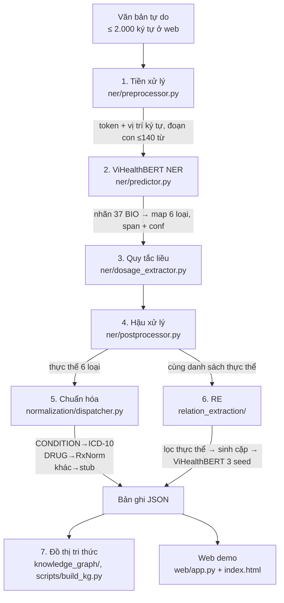
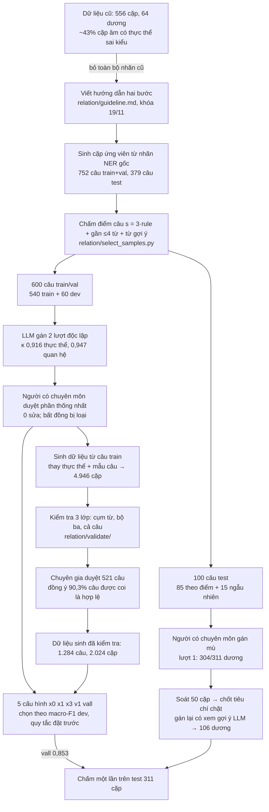

# Ôn tập pipeline để bảo vệ

Số liệu lấy từ báo cáo **v38** (24/11/2026) và đối chiếu với mã nguồn. Số mục và số bảng ghi theo đúng báo cáo để bạn lật trang nhanh khi bị hỏi. Tài liệu này đi kèm [KICH_BAN_BAO_VE_15_PHUT.md](KICH_BAN_BAO_VE_15_PHUT.md) (lời nói khi trình bày) và [GHI_CHU_CAC_CON_SO.md](GHI_CHU_CAC_CON_SO.md) (căn cứ của các ngưỡng). Ở đây tập trung vào câu hỏi "từng bước làm gì, vì sao làm vậy, nằm ở file nào".

---

## 0. Nói pipeline trong 60 giây

> Hệ thống nhận một đoạn văn bản y tế tiếng Việt và trả về một bản ghi JSON. Phần NER gồm ba bước: tiền xử lý tách token và chia đoạn mà vẫn giữ vị trí ký tự, ViHealthBERT gán nhãn BIO cho từng từ, rồi quy tắc liều và hậu xử lý sửa các lỗi đã biết, cho ra thực thể thuộc sáu loại. Sau đó luồng tách thành hai nhánh độc lập. Nhánh chuẩn hóa gán mã ICD-10 cho CONDITION và RxNorm cho DRUG, theo nguyên tắc thà không gán còn hơn gán sai. Nhánh RE lọc bỏ thực thể chung chung hoặc không hợp lệ, sinh mọi cặp đúng kiểu theo lược đồ năm quan hệ, rồi một ViHealthBERT có ký hiệu đánh dấu thực thể phân loại từng cặp là có hay không có quan hệ. Gộp kết quả của nhiều văn bản lại thì được đồ thị tri thức, trong đó mỗi nút là một khái niệm, có mã chuẩn nếu đã tra được.

Ba nguyên tắc thiết kế (mục 3.4): (1) mọi thực thể giữ **vị trí ký tự** trong cùng một văn bản, (2) chuẩn hóa và RE là **hai nhánh độc lập**, (3) luôn phân biệt **"không có kết quả"** với **"không đủ căn cứ"** (trả NIL, đánh dấu `re_excluded`).

---

## 1. Sơ đồ toàn luồng

Điểm phải nhấn mạnh khi chỉ vào sơ đồ: mũi tên từ bước 4 tách đôi. Chuẩn hóa và RE **không cần đầu ra của nhau**, nên một thuốc không tra được mã RxNorm vẫn được nối với bệnh. Ngược lại, đồ thị thì cần cả hai, vì khóa của nút là mã chuẩn nếu có.

### Một câu đi qua từng bước (Ví dụ 3.1, chạy thật)

`"Bệnh nhân đau ở vùng bụng, được điều trị bằng phẫu thuật."`

| Bước | Kết quả |
|---|---|
| Tiền xử lý | Tách "bụng" và "," thành hai token riêng, mỗi token giữ vị trí ký tự |
| NER | E1 CONDITION "đau" (10–13, 0,9964); E2 BODY_PART "vùng bụng" (16–25, 0,77); E3 PROCEDURE "điều trị" (32–40); E4 PROCEDURE "phẫu thuật" (46–56) |
| Chuẩn hóa | "đau" → ICD-10 (nếu khớp), BODY_PART/PROCEDURE → stub, không có mã |
| Lọc RE | E3 "điều trị" bị đánh dấu `re_excluded = generic_entity` |
| Sinh cặp | (E1,E2) kiểu CONDITION–BODY_PART → located_at; (E1,E4) CONDITION–PROCEDURE → treated_by_procedure |
| Phân loại | Cả hai cặp score 1,000 ≥ 0,5 → dương |

Nên thuộc ví dụ này, vì khi bị hỏi bước nào cũng có thể quay về đây để minh họa.

---

## 2. Phần NER (bước 1–4)

### 2.1. Dữ liệu và ánh xạ nhãn (mục 3.3.1–3.3.2, Bảng 3.2–3.3)

VietMed-NER là bản chép lời của **lời nói y tế** (hội thoại, chương trình tư vấn, quảng cáo), không phải bệnh án viết. Bộ này có 18 loại thực thể, gán theo lược đồ BIO nên có 37 nhãn (2 × 18 + O).

| Phần chia | Số câu | Từ/câu | Dùng cho |
|---|---:|---:|---|
| train | 4.616 | 24,1 | Mô hình NER đã học; nguồn câu RE train/dev |
| validation | 1.154 | 24,0 | Dev cho chuẩn hóa; góp câu RE |
| test | 3.497 | 22,2 | Chấm NER, chuẩn hóa, RE; dựng đồ thị |

Ánh xạ 18 → 6 nằm trong `ner/config.py`:

| Mục tiêu | Nhãn gốc |
|---|---|
| CONDITION | DISEASESYMTOM |
| DRUG | DRUGCHEMICAL, PREVENTIVEMED |
| BODY_PART | ORGAN |
| TEST | DIAGNOSTICS |
| PROCEDURE | SURGERY, MEDDEVICETECHNIQUE, TREATMENT |
| DOSAGE | UNITCALIBRATOR |
| bỏ | AGE, GENDER, DATETIME, OCCUPATION, LOCATION, ORGANIZATION, FOODDRINK, PERSONALCARE, TRANSPORTATION |

Ánh xạ này kéo theo ba hệ quả mà hội đồng hay hỏi:
- Vì TREATMENT được gộp vào PROCEDURE, các từ chung như "điều trị" cũng thành PROCEDURE. Đây là lý do có bộ lọc thực thể chung chung ở bước RE.
- UNITCALIBRATOR rộng hơn khái niệm liều, vì gồm cả số đo, mức độ và tỉ lệ. Hệ quả là DOSAGE có precision thấp (F1 chặt 0,437).
- PREVENTIVEMED (chủ yếu là vắc-xin) được gộp vào DRUG, nên câu tiêm phòng sinh ra cặp CONDITION–DRUG, trong khi theo quy ước đó là phòng ngừa chứ không phải điều trị.

Các loại phi y khoa bị bỏ hẳn, không gộp thành nhãn "OTHER", vì mô hình rất tự tin gán "bệnh nhân" là OCCUPATION.

### 2.2. Bước 1, tiền xử lý (`ner/preprocessor.py`, mục 3.4.2)

- `normalize_whitespace`: thay khoảng trắng không ngắt và tab, gộp nhiều dấu cách, giới hạn số dòng trống. Bước này **không sửa** số, đơn vị hay ký hiệu y khoa.
- `tokenize_words`: tách bằng regex, mỗi dấu câu thành một token riêng ("dạ dày," → "dạ", "dày", ","). Mỗi token giữ `(start, end)`.
- `chunk_tokens`: chia đoạn con, luôn cắt ở ranh giới từ. Có bốn ngưỡng: tách ở dấu câu khi đoạn ≥ 35 từ; tách ở dấu câu nếu cả hai phía ≥ 15 từ; tách ở dấu phẩy hoặc chấm phẩy từ 120 từ; cắt cứng ở 140 từ.
- Căn cứ của ngưỡng 140: mỗi từ ứng với tối đa 1,42 subword, nên 140 từ ≈ 198 subword < 200 (mức an toàn) < 256 (giới hạn của mô hình). Ba ngưỡng 15, 35, 120 là giá trị kinh nghiệm. Câu dài nhất trong VietMed-NER chỉ có 40 từ, nên các ngưỡng này không ảnh hưởng tới kết quả báo cáo.

Vì sao giữ vị trí ký tự: chuẩn hóa, RE (chèn marker) và giao diện (tô màu) đều cần cắt đúng `text[start:end]`. Hàm `validate_entities` trong `relation_extraction/data.py` sẽ báo lỗi nếu chuỗi bề mặt không khớp với vị trí.

### 2.3. Bước 2, mô hình NER (`ner/predictor.py`, mục 3.4.3, Bảng 3.9, Mã giả 3.1)

- Mô hình: `Model/vihealthbert-ner-vietmed-v2-final`, nền ViHealthBERT-base bản âm tiết (RoBERTa, 12 lớp, 12 head, kích thước ẩn 768), thêm lớp tuyến tính 768 × 37. **Mô hình này kế thừa, khóa luận không huấn luyện lại.** Siêu tham số do người huấn luyện ban đầu chọn: lr 5e-5, 30 epoch, batch 32, AdamW, weight decay 0,01.
- Quy trình suy luận cho mỗi đoạn con:
  1. Tách mỗi từ thành subword và ghi lại subword nào thuộc từ nào (`owner`).
  2. Thêm `<s>` và `</s>`, đưa vào mô hình rồi lấy softmax.
  3. **Bỏ hai vị trí đặc biệt** trước khi giải mã, vì lúc huấn luyện các vị trí này không có nhãn nên dự đoán tại đó gần như ngẫu nhiên.
  4. Nhãn của một từ lấy theo **subword đầu tiên**. Độ tin cậy của từ là **trung bình** xác suất cao nhất của các subword.
  5. Ánh xạ sang 6 loại rồi giải mã BIO thành span.

### 2.4. Bước 3, quy tắc liều (`ner/dosage_extractor.py`, mục 3.4.4)

Regex bắt ba thành phần: giá trị số (kể cả "nửa", "hai", "1-2"), đơn vị hoặc dạng bào chế (mg, ml, IU, viên, ống, gói) và tần suất ("2 lần/ngày", "ngày 3 lần", "cách 8 giờ"). Kết quả được gộp với DOSAGE của mô hình, khi chồng lấn thì giữ cụm đầy đủ hơn. Trên tập test, quy tắc này chỉ thêm 1 dự đoán đúng và 2 dự đoán sai, vì lời nói hiếm khi chứa cụm "500mg 2 viên/ngày".

### 2.5. Bước 4, hậu xử lý (`ner/postprocessor.py`, mục 3.4.5, Mã giả 3.2)

Thứ tự áp dụng:
1. `FilterSchema`: chỉ giữ 6 loại.
2. Quy tắc 1: bỏ DRUG là từ hành động ("chỉ định", "can thiệp", "kê đơn", "điều trị").
3. Quy tắc 1b: đổi DRUG thành TEST với tên xét nghiệm đã biết (men tim, men gan, troponin, HbA1c, CRP). Quy tắc này được thêm sau khi thấy "men tim" nằm trong `unmatched_drugs.log`.
4. Quy tắc 2: gộp tính từ mức độ ("cao", "nhẹ", "nặng") bị gán DOSAGE vào CONDITION đứng ngay trước, ví dụ "sốt cao". Độ tin cậy lấy trung bình hai bên.
5. Giải chồng lấn theo kiểu tham lam: sắp theo conf giảm dần rồi độ dài giảm dần, nhận thực thể nào không chồng với thực thể đã nhận, cuối cùng sắp lại theo vị trí.

### 2.6. Kết quả NER phải thuộc (mục 4.1)

| Chỉ số | Giá trị |
|---|---|
| Mô hình gốc, 18 loại, micro-F1 | 0,6572 (P 0,5996, R 0,7269, 8.338 thực thể) |
| Toàn luồng, 6 loại, F1 khớp chặt | **0,6223** (P 0,5642, R 0,6938) |
| Toàn luồng, F1 khớp nới lỏng | **0,7536**; số TP tăng từ 3.575 lên 4.329 |
| Chỉ dùng mô hình | 0,6209 → quy tắc chỉ thêm **+0,0014** |
| Baseline từ điển / CRF / ViHealthBERT (6 loại) | 0,576 / 0,567 / **0,621**, CI không chồng nhau; recall 0,546 / 0,547 / 0,694 |
| Theo loại, F1 chặt | DOSAGE 0,437 (thấp nhất), PROCEDURE 0,508, BODY_PART 0,633; TEST và DRUG cao nhất |
| Tốc độ (CPU, tắt chuẩn hóa) | trung bình 103,3 ms/câu, trung vị 100,3, p95 139,1; 3.497 câu hết 362 giây |
| Val 0,880 so với test 0,657 | Không phải rò rỉ: baseline chỉ học trên train cũng giảm (từ điển 0,911 → 0,664). 7,5% câu val trùng cụm 8 từ với train, ở test chỉ 0,3% |

---

## 3. Nhánh chuẩn hóa (bước 5)

### 3.1. Kiến trúc (`normalization/`)

- `base.py` là giao diện chung. Kết quả gồm `ontology`, `code`, `label_standard`, `match_method`, `match_score`.
- `dispatcher.py` (`EntityNormalizationPipeline`) định tuyến CONDITION sang `icd10.py`, DRUG sang `rxnorm.py`, BODY_PART/TEST/PROCEDURE sang `stubs.py` (khung FMA/LOINC/MeSH, chưa trả mã), còn DOSAGE thì bỏ qua vì đã được tách thành giá trị, đơn vị và tần suất. Mỗi bộ chuẩn hóa chỉ được nạp khi cần (lazy). Bộ điều phối bắt mọi ngoại lệ để một lỗi tra mã không làm hỏng cả bản ghi, và ghi thời gian xử lý vào log.
- Muốn thêm LOINC thì chỉ cần viết thêm một lớp cài đặt giao diện đó, không phải sửa luồng.

### 3.2. ICD-10 (`normalization/icd10.py`, mục 3.4.6.1, Mã giả 3.3)

Danh mục của Bộ Y tế gồm **12.218 mã**, 12.059 tên khác nhau. Cả tên trong danh mục lẫn truy vấn đều được đưa về chữ thường, bỏ dấu câu và gộp khoảng trắng. Hệ thống thử lần lượt và dừng ở bước đầu tiên cho kết quả:

1. **Khớp chính xác** với tên trong danh mục.
2. **Từ điển tên gọi khác** (`icd10_synonyms.json`): 170 tên, trong đó 137 tên mới chỉ lấy từ các dạng có trong train và dev. Có thêm mẫu biến đổi như "ung thư X" → "u ác của X".
3. **Fuzzy matching** bằng `token_set_ratio` với ngưỡng ≥ 85, kèm **sáu ràng buộc an toàn** (Bảng 3.11):
   - tỉ lệ độ dài hai chuỗi ≥ 0,60 ("viêm" so với "viêm phổi thùy" chỉ 0,29, bị chặn);
   - Jaccard ≥ 0,40 khi cả hai chuỗi có tối đa 3 từ ("đau bụng" với "đau lưng" là 0,33, bị chặn; "đau bụng" với "đau bụng cấp" là 0,67, được giữ);
   - bỏ các từ định tính ("không xác định", "bệnh") rồi so lại;
   - từ đầu cụm của ứng viên phải có trong truy vấn ("huyết áp cao" không được khớp với "đo huyết áp");
   - từ chối khi chuỗi ngắn chỉ có 1–2 từ và là tập con thực sự ("nhồi máu" không được khớp với "nhồi máu lách");
   - mọi từ nội dung của ứng viên phải có trong truy vấn, so sau khi bỏ dấu với độ tương tự ≥ 80 (cho phép sai một ký tự ở từ năm ký tự).
4. Nếu không bước nào đạt thì trả **NIL**.

Vì sao không chỉ nâng ngưỡng: "tăng huyết áp vô căn" với "hạ huyết áp vô căn" vẫn đạt 91, "viêm gan virus B" với "viêm gan virus C" đạt 94. Ngoài ra `token_set_ratio` cho 100 điểm khi tập từ của chuỗi này nằm trọn trong chuỗi kia. Vì vậy bản sửa dựa vào **ràng buộc cấu trúc**, không dựa vào ngưỡng.

### 3.3. RxNorm (`normalization/rxnorm.py`, mục 3.4.6.2)

- Làm sạch tên (bỏ hàm lượng, dạng bào chế) rồi gọi API RxNav để lấy RxCUI. Mỗi lần gọi chờ tối đa 5 giây, thử lại tối đa 3 lần với khoảng chờ tăng dần.
- Mọi kết quả, **kể cả không tìm thấy**, đều được lưu vào `rxnorm_cache.db`, nên có thể chạy lại khi không có mạng. Thuốc không tra được được ghi vào `unmatched_drugs.log`.
- Bản cải tiến (chọn trên dev) có ba bước bổ sung: từ điển Việt → Anh 31 mục ("canxi" → calcium, "sắt" → iron), bỏ từ chỉ dạng bào chế hoặc vật chứa ở đầu ("viên nang", "chai", "thuốc"), và tìm gần đúng qua RxNav nhưng chỉ nhận khi độ tương tự ≥ 90.
- Ngưỡng 90 cao hơn 85 của ICD-10 vì dịch vụ tìm gần đúng **luôn trả về** một ứng viên, kể cả khi thuốc không có trong RxNorm.

### 3.4. Hai chế độ và top-k (mục 3.4.6.4, Mã giả 3.4)

- **Chế độ chặt** (mặc định): chỉ gán mã khi một trong ba bước so khớp đưa ra quyết định.
- **Chế độ luôn gán**: nếu không có quyết định thì lấy ứng viên đứng đầu. Chế độ này dành cho trường hợp luôn có người xác nhận phía sau.
- Mỗi CONDITION và DRUG mang danh sách **k = 5** ứng viên. Với ICD-10, các ứng viên được xếp hạng bằng **TF-IDF trên n-gram ký tự độ dài 2–4** (chọn trên dev, tốt hơn fuzzy và n-gram từ). Với RxNorm, ứng viên lấy từ dịch vụ tìm gần đúng của RxNav. Ứng viên do bước xếp hạng sinh ra mang nhãn `retrieval`, nên chế độ chặt không bao giờ coi chúng là quyết định.

### 3.5. Kết quả chuẩn hóa (mục 4.2, Bảng 4.3)

Tập đánh giá đếm theo **dạng bề mặt** (chuỗi khác nhau sau khi đưa về chữ thường), gồm dev 321 dạng và test 440 dạng. **Nhãn do LLM gán**, có phiếu duyệt đi kèm.

| | Khớp chính xác | Fuzzy không ràng buộc | Chặt | Luôn gán |
|---|---:|---:|---:|---:|
| ICD-10, độ chính xác | 0,069 | 0,187 | **0,354** | 0,520 |
| ICD-10, precision khi trả lời | 1,000 | 0,187 | **1,000** | 0,520 |
| ICD-10, từ chối đúng NIL | 0,985 | 0 | **0,985** | 0 |
| RxNorm, độ chính xác | 0,404 | 0,468 | **0,638** | 0,681 |

Các số khác cần nhớ: RxNorm đạt 0,889 khi tính theo đề cập. Top-10 ICD-10 đạt **69,1%** (76,8% ở mức nhóm ba ký tự). Dev ICD-10 đạt 0,796 nhưng test chỉ 0,354, vì từ điển tên gọi khác lấy từ train và dev, và val rất gần train. Khảo sát ban đầu trên 402 đề cập: bản đầu gán 71 mã, có **13 mã sai, tất cả do fuzzy**; sau bản sửa gán 74 mã và không còn mã sai.

---

## 4. Nhánh RE (bước 6), chạy lúc suy luận

Mã nguồn nằm trong `relation_extraction/`: `data.py` (lược đồ, lọc, sinh cặp, marker), `rules.py` (baseline), `bert_model.py` (mô hình), `pipeline.py` (`MedicalREPipeline`). Lược đồ nằm trong `re_labels.json`.

### 4.1. Lược đồ năm quan hệ

| Quan hệ | Head → Tail |
|---|---|
| located_at | CONDITION → BODY_PART |
| treated_by | CONDITION → DRUG |
| treated_by_procedure | CONDITION → PROCEDURE |
| diagnosed_by | CONDITION → TEST |
| has_dosage | DRUG → DOSAGE |

Mỗi cặp kiểu (head, tail) chỉ ứng với **đúng một quan hệ**. Vì vậy bài toán là **phân loại nhị phân** (quan hệ đó hoặc NO_RELATION), không phải phân loại 6 lớp. Đây là câu hỏi rất dễ bị hỏi. Quan hệ chỉ xét trong một câu (một đoạn).

### 4.2. Lọc thực thể trước khi sinh cặp (mục 3.4.7.1)

`MedicalREPipeline.from_ner_result` đánh dấu hai nhóm thực thể:
- `GENERIC_ENTITIES` → `re_excluded = generic_entity`. Ví dụ PROCEDURE "điều trị", "trị liệu"; DRUG "thuốc", "hoạt chất"; TEST "khám", "chẩn đoán", "đo".
- `GUIDELINE_INVALID` → `re_excluded = guideline_invalid`. Đây là các dạng mà hướng dẫn gán nhãn coi là INVALID: DRUG "kiểm soát", "phòng ngừa", "tầm soát", "protein"; PROCEDURE "phục hồi", "uống thuốc"; DOSAGE "cao", "tỷ lệ", "phần trăm"; TEST "nghiên cứu", "chuyển hóa".

Các thực thể này **vẫn có trong đầu ra** để chuẩn hóa và hiển thị (giao diện tô mờ), nhưng không tham gia sinh cặp. Mục đích là để đầu vào RE lúc suy luận khớp với quy ước của dữ liệu huấn luyện, nơi bước 1 của hướng dẫn đã loại các thực thể INVALID. Có thể tắt bằng `skip_generic=False`.

### 4.3. Sinh cặp và đánh dấu (`data.py: candidates`, `mark_pair`)

- Trước tiên `validate_entities` kiểm tra ID không trùng, vị trí hợp lệ, nhãn thuộc lược đồ, văn bản khớp với vị trí và **không có span chồng lấn**.
- Duyệt mọi cặp (head, tail) có kiểu trùng một quan hệ. Chiều của quan hệ luôn đúng kể cả khi head đứng sau tail trong câu.
- Marker có kèm loại thực thể được chèn **từ cuối câu về đầu** để không làm lệch vị trí ký tự:
  `[HEAD_CONDITION]đau[/HEAD] ở [TAIL_BODY_PART]vùng bụng[/TAIL], được điều trị bằng phẫu thuật.`

### 4.4. Mô hình ViHealthBERT-RE (`bert_model.py`, mục 3.4.7.3)

- Nền là `demdecuong/vihealthbert-base-syllable`. Các marker (`[HEAD_<loại>]`, `[TAIL_<loại>]`, `[/HEAD]`, `[/TAIL]`) được thêm vào tokenizer như token đặc biệt, sau đó gọi `resize_token_embeddings`.
- `PairClassifier`: biểu diễn cặp là **nối hai vector ẩn tại marker mở đầu** của head và của tail (2 × 768 = 1.536 chiều), qua dropout 0,1 và một lớp tuyến tính ra 2 lớp. Đây là kiểu "entity start" của Baldini Soares và cộng sự (2019) và Zhong và Chen (2021).
- Siêu tham số **cố định trước, không tinh chỉnh**: 10 epoch, lr 3e-5, batch 16, warmup 10%, weight decay 0,01, max_len 192, trọng số lớp bằng n_âm/n_dương.
- **Ba seed (42, 43, 44)**: lấy trung bình xác suất lớp dương, dương khi ≥ **0,5**. Lý do là dữ liệu nhỏ nên khởi tạo ngẫu nhiên làm kết quả dao động mạnh. Điểm số là xác suất **chưa hiệu chỉnh**, có ghi trong `re_metadata.score_meaning`.
- Huấn luyện trên GTX 1650 4 GB, mất khoảng 6.987 giây cho cả ba seed. Trọng số `model_seed42/43/44.safetensors` không có trong git. Cấu hình nằm trong `Model/vihealthbert-re-vietmed-validated/re_config.json`.
- Mô hình triển khai dùng `HybridRelationExtractor(mode="fallback")`: dùng mô hình cho các quan hệ nó hỗ trợ, dùng luật cho các quan hệ còn lại. Vì mô hình hỗ trợ cả năm quan hệ, **thực chất đây là mô hình đứng một mình**. Cách hợp (union) với luật cho 0,682, thấp hơn 0,693 của mô hình.

### 4.5. Baseline rule-based (`rules.py`, Bảng 3.12)

Viết thẳng từ hướng dẫn gán nhãn, không tinh chỉnh. Một cặp là dương khi thỏa đồng thời ba điều kiện: (1) khoảng cách giữa hai thực thể không vượt ngưỡng của quan hệ, (2) đoạn giữa có từ gợi ý, hoặc hai thực thể liền kề đối với located_at và has_dosage, (3) không có thực thể cùng loại chen giữa.

| Quan hệ | Khoảng cách tối đa | Từ gợi ý |
|---|---:|---|
| located_at | 4 | ở, tại, vùng, trong, của, phía, bên… hoặc liền kề |
| treated_by | 8 | điều trị, chữa, bằng, dùng, uống, tiêm, bôi, kê… |
| treated_by_procedure | 8 | điều trị, phương pháp, can thiệp, tiến hành… |
| diagnosed_by | 8 | chẩn đoán, phát hiện, xác định, cho thấy, xét nghiệm… |
| has_dosage | 3 | chỉ xét trường hợp liền kề |

---

## 5. Pipeline dữ liệu RE (offline, đóng góp chính)

Đây là phần hội đồng sẽ hỏi kỹ nhất, vì đây là **đóng góp dữ liệu** của khóa luận và cũng là chỗ có LLM tham gia.

### 5.1. Vì sao phải làm lại

Ở bộ cũ, thực thể lấy thẳng từ nhãn NER, nên khoảng **43% cặp âm có thực thể sai kiểu** (ví dụ "kiểm soát" bị gán là thuốc). Mô hình học trên bộ đó chủ yếu học cách nhận ra thực thể sai, không học quan hệ. Bộ mới đặt **bước kiểm tra thực thể (VALID/INVALID)** trước bước gán quan hệ.

### 5.2. Hướng dẫn hai bước (Phụ lục C)

- Bước 1: xét từng lượt đề cập, chọn VALID hoặc INVALID. Ví dụ "huyết áp" là VALID khi mang nghĩa bệnh tăng huyết áp, nhưng INVALID khi chỉ con số đo.
- Bước 2: chỉ gán nhãn cho cặp có cả hai thực thể VALID, nhãn là tên quan hệ hoặc NO_RELATION.
- Người gán chỉ dựa vào điều câu nói ra, không dùng kiến thức bên ngoài để bù cho phần câu bị cắt. Hướng dẫn có quyết định riêng cho các trường hợp tác dụng phụ, phòng bệnh, phủ định và câu hỏi.

### 5.3. Chọn câu (mục 3.3.3.3, công thức 3.1)

`s(h,t) = 3·[quy tắc đoán dương] + [khoảng cách ≤ 4 từ] + [có từ gợi ý]`, điểm của câu là tổng điểm các cặp. Hệ số 3 vì tín hiệu từ quy tắc là mạnh nhất (đòi hỏi đồng thời cả ba điều kiện). Hệ số và ngưỡng được đặt trước, **không tinh chỉnh**, vì điểm này chỉ dùng để chọn câu chứ không dùng làm nhãn. Câu được chọn theo hạn mức của từng quan hệ, ưu tiên quan hệ hiếm, cộng thêm một phần câu ngẫu nhiên.

### 5.4. Tập kiểm tra (mục 3.3.3.4, Bảng 3.5)

- 100 câu của phần test, 388 lượt đề cập, 18 lượt bị INVALID, còn **311 cặp**. Một người có chuyên môn y khoa gán. Câu được xáo trộn, phiếu không hiện dự đoán của quy tắc hay của LLM.
- Lượt đầu cho 304/311 cặp dương, tức gần như coi mọi cặp cùng câu là có quan hệ. Mốc luôn dương khi đó đạt 0,989, nên tập này không đánh giá được mô hình.
- Soát 50 cặp mà không cho xem nhãn cũ: người gán kết luận được 19 cặp, cả 19 đều được đánh lại là không có quan hệ (kể cả 7 cặp đối chứng). Từ đó chốt **tiêu chí chặt**: cùng xuất hiện trong câu chưa đủ để gán quan hệ.
- Gán lại toàn bộ 311 cặp, có xem nhãn gợi ý của LLM rồi xác nhận hoặc sửa → **106 cặp dương** (located_at 53, treated_by 14, treated_by_procedure 14, diagnosed_by 15, has_dosage 10). Kappa giữa nhãn gán lại và nhãn LLM gán độc lập trên 244 cặp là 0,992.

### 5.5. Tập huấn luyện và kiểm định (mục 3.3.3.5, Bảng 3.6)

- LLM gán hai lượt độc lập: kappa 0,916 ở bước thực thể và 0,947 ở bước quan hệ. Người có chuyên môn duyệt phần hai lượt thống nhất và **không sửa nhãn nào**. Phần bất đồng bị loại (53 lượt đề cập, 33 cặp, kéo theo 77 cặp khác).
- Train: 1.169 cặp, tỉ lệ dương 37,3%. has_dosage = **0 cặp**, diagnosed_by chỉ có ở train (20 dương). Dev: 60 câu, 111 cặp, 49 dương, chỉ có ba quan hệ.

### 5.6. Dữ liệu sinh và kiểm tra (mục 3.3.3.6–3.3.3.7, `relation/synth.py`, `relation/validate/`)

- **Chỉ sinh từ câu train.** Có hai cách: thay một thực thể bằng thực thể cùng kiểu và cùng nhóm chuyên khoa (giữ nhãn), và điền cặp thực thể vào mẫu câu viết tay, gồm mẫu dương và **mẫu âm khó** (phòng bệnh, tác dụng phụ, phủ định, thực thể gây nhiễu).
- Loại câu trùng và câu có chung **chuỗi 8 từ** với dev hoặc test. Mỗi khung câu giữ tối đa 3 câu. Tỉ lệ dương được đưa về 32–42%. Tổng cộng có 4.946 cặp.
- Kiểm tra ba lớp cho mỗi câu (`units.py` → `evidence.py` → `verdict.py`):
  - K1 **cụm từ mới** quanh thực thể được thay ("đau thận"): tra trong câu VietMed-NER và tên ICD-10.
  - K2 **bộ ba dương**: tra MED-RT, RxNorm, BioText, ADE, trang WHO/NIH.
  - K3 **cả câu**: dịch sát nghĩa sang tiếng Anh rồi để LLM chấm độ hợp lý y khoa.
- Kết quả trên 2.874 câu: 1.337 hợp lệ, 1.537 không hợp lệ (1.413 câu bị loại vì ngữ cảnh). Chuyên gia duyệt 521 câu bằng phiếu 1/2 và đồng ý với **90,3%** số câu được coi là hợp lệ, nhưng chỉ đồng ý với 21,7% số câu bị loại vì ngữ cảnh. Nghĩa là K3 khắt khe hơn người duyệt, nên các câu bị loại mà người duyệt giữ lại được đưa trở lại tập sinh.
- Sau kiểm tra còn 1.284 câu, **2.024 cặp** (353 câu qua người duyệt, 931 câu qua kiểm tra tự động).

### 5.7. Chọn cấu hình (mục 4.3.1, Bảng 4.4)

| Cấu hình | Cặp train | P | R | micro-F1 | **macro-F1 dev** |
|---|---:|---:|---:|---:|---:|
| x0, chỉ thật | 1.169 | 0,907 | 0,796 | 0,848 | 0,796 |
| x1, sinh chưa kiểm tra ×1 | 2.338 | 0,929 | 0,796 | 0,857 | 0,826 |
| x3, sinh chưa kiểm tra ×3 | 4.678 | 0,949 | 0,755 | 0,841 | 0,777 |
| v1, sinh đã kiểm tra ×1 | 2.338 | 0,952 | 0,816 | 0,879 | 0,835 |
| **vall**, toàn bộ sinh đã kiểm tra | 3.193 | 0,911 | 0,837 | 0,872 | **0,853** ✔ |

Quy tắc chọn được đặt trước: macro-F1 cao nhất trên dev, bằng nhau thì chọn cấu hình ít dữ liệu sinh hơn. Dùng macro thay vì micro vì located_at chiếm phần lớn cặp. **Cần nói thật**: v1 và vall được thêm vào sau, khi bước kiểm tra dữ liệu sinh hoàn tất, và cũng được chọn theo đúng quy tắc đó. Chênh lệch giữa các cấu hình chỉ là vài cặp trên 49 cặp dương của dev.

---

## 6. Kết quả RE (mục 4.3.2, Bảng 4.5–4.6)

| Phương pháp | P | R | **F1** | CI 95% |
|---|---:|---:|---:|---|
| **ViHealthBERT (vall)** | 0,595 | 0,830 | **0,693** | 0,623–0,755 |
| Rule-based | 0,750 | 0,425 | 0,542 | 0,446–0,634 |
| ViHealthBERT ∪ rule | 0,574 | 0,840 | 0,682 | 0,613–0,747 |
| Luôn dương | 0,341 | 1,000 | 0,508 | 0,441–0,580 |

Chênh lệch giữa mô hình và rule-based có **CI [0,048; 0,258], không chứa 0**, nên có ý nghĩa thống kê. Hợp với luật chỉ thêm 1 cặp đúng nhưng thêm 6 cặp sai.

| Quan hệ | Cặp | Dương | P | R | F1 mô hình | F1 rule |
|---|---:|---:|---:|---:|---:|---:|
| located_at | 161 | 53 | 0,821 | 0,868 | **0,844** | 0,714 |
| treated_by | 32 | 14 | 0,632 | 0,857 | 0,727 | 0,500 |
| treated_by_procedure | 49 | 14 | 0,273 | 0,429 | **0,333** | 0,000 |
| diagnosed_by | 35 | 15 | 0,560 | 0,933 | 0,700 | 0,235 |
| has_dosage | 34 | 10 | 0,385 | 1,000 | 0,556 | 0,333 |

Lỗi (mục 4.6.3) gồm 60 dương giả và 18 bỏ sót:
- **has_dosage**: 16 dương giả, đều là thuốc đứng cạnh một con số không phải liều ("bảy mươi phần trăm là canxi"). Nguyên nhân là mô hình chỉ học quan hệ này từ câu sinh, nơi thuốc đứng cạnh một lượng gần như luôn là liều.
- **treated_by_procedure**: 16 dương giả và 8 bỏ sót. Dương giả có hai dạng: PROCEDURE thực chất không phải thủ thuật ("phục hồi", "hạ sốt" lọt qua bộ lọc) và quan hệ nhân quả ngược ("biến chứng do nhổ răng"). Bỏ sót chủ yếu là thủ thuật nha khoa.
- **located_at**: dương giả từ câu liệt kê, bỏ sót khi bộ phận ở xa bệnh. Cả hai cho thấy mô hình vẫn dựa nhiều vào khoảng cách.

---

## 7. Đồ thị tri thức (bước 7, mục 3.4.12, 4.5)

- `scripts/build_kg.py --split test` dựng đồ thị từ 3.496 câu khác nhau của test (bỏ trùng và câu rỗng). Thực thể do **NER sinh ra** (giống như khi chạy thật, không dùng nhãn chuẩn), chuẩn hóa ở chế độ chặt, RE bằng mô hình vall. Trước khi dựng, mô hình được nạp lại từ ba seed đã lưu và cho dự đoán trùng với lần chấm ở cả 311 cặp.
- **Khóa của nút** (`knowledge_graph/graph.py: node_key`) là mã chuẩn nếu chuẩn hóa có quyết định (ví dụ `ICD-10:E14`), nếu không thì là `LOẠI:chữ đã chuẩn hóa` (ví dụ `BODY_PART:xương`). Ứng viên gợi ý không bao giờ được dùng làm khóa. Nhờ vậy "tiểu đường uống metformin" và "đái tháo đường dùng metformin" gộp về cùng cạnh E14 → RxNorm 6809 với số lần bằng 2.
- Cạnh được gộp theo bộ ba, lưu số lần xuất hiện, số văn bản, nguồn (model/rule), điểm trung bình và tối đa 3 câu ví dụ. Các CONDITION chung chung ("bệnh", "triệu chứng") bị bỏ để không thành nút trung tâm giả.
- Kết quả: **1.315 nút** (107 nút có mã), **433 cạnh khác nhau** ứng với 519 lần xuất hiện, 886 nút cô lập. So với đồ thị cũ (256 cạnh, 178 cạnh chung): has_dosage tăng từ 7 lên 81 lần, treated_by từ 31 lên 89, located_at gần như không đổi.
- Lỗi do NER để lại: "thính giả" bị tách thành "thính" (CONDITION) và "giả" (DRUG) rồi được nối treated_by 5 lần; "thuyên tắc huyết khối" bị cắt thành "thuyên tắc huyết". Đây là bằng chứng định tính cho câu hỏi nghiên cứu số 2.
- Xuất ra file và trang web tương tác (`visualize.py`, kg.html): lọc theo quan hệ và số lần tối thiểu, tìm kiếm, bấm vào nút hoặc cạnh để xem câu nguồn. Nút chưa có mã được vẽ viền đứt.

## 8. Web demo (mục 3.4.11)

- Backend là `web/app.py` (FastAPI): nạp pipeline ở luồng nền khi khởi động (khoảng 26 giây). Trong lúc nạp, `/api/analyze` trả 503. Có hai endpoint là `GET /api/health` và `POST /api/analyze {text ≤ 2000 ký tự, normalize}`. Các yêu cầu được xử lý lần lượt qua một khóa, vì pipeline không an toàn khi chạy song song.
- Frontend là `web/index.html` với ba phần: tô màu thực thể theo 6 loại (thực thể bị loại khỏi RE hiển thị mờ), bảng thực thể (conf, mã, tên chuẩn, cách khớp, top-k), và danh sách quan hệ (nguồn, điểm).
- Thời gian 0,4–2,7 giây mỗi câu trên CPU. Cách chạy: `.venv\Scripts\python.exe -X utf8 web/app.py` rồi mở http://127.0.0.1:8770.

## 9. Giao thức đánh giá (mục 3.1, Bảng 3.1, 3.8)

| Thành phần | Học | Chọn | Báo cáo | Nguồn nhãn |
|---|---|---|---|---|
| NER | train (mô hình kế thừa; 2 baseline tự huấn luyện) | val cho baseline | test 3.497 câu | người gán của VietMed-NER |
| Chuẩn hóa | không học tham số; từ điển lấy dạng từ train và dev | dev 321 dạng | test 440 dạng, chạy một lần | LLM |
| RE | 540 câu (1.169 cặp) + 2.024 cặp sinh | dev 60 câu (111 cặp) | test 100 câu (311 cặp) | LLM ×2 + người duyệt / người có chuyên môn |
| Đồ thị | – | – | 3.496 câu test | dự đoán của hệ thống |

- NER dùng F1 mức thực thể (vì đa số token mang nhãn O), khớp chặt là chỉ số chính, khớp nới lỏng báo kèm.
- RE dùng micro-F1 **trên nhãn dương** (cặp âm chiếm 65,9% tập test). Khoảng tin cậy tính bằng **bootstrap 2.000 lần theo câu**, vì các cặp trong cùng câu không độc lập. Chỉ kết luận một phương pháp tốt hơn khi CI của **chênh lệch** không chứa 0.
- Độ đồng thuận dùng Cohen's kappa thay vì tỉ lệ đồng ý thô.
- Chống rò rỉ: kiểm tra trùng cả nguyên câu lẫn chuỗi 8 từ, dữ liệu sinh chỉ lấy từ câu train, mọi tập báo cáo đều từ phần test.
- Kiểm thử: **115 ca**, chạy ngày 23/11 đều đạt (30,1 giây). Kiểm thử chỉ xác nhận hệ thống chạy đúng thiết kế, **không đo chất lượng dự đoán**.

---

## 10. Câu hỏi về cơ chế pipeline (bổ sung cho bảng hỏi đáp trong kịch bản)

| Câu hỏi | Ý trả lời |
|---|---|
| Vì sao RE là phân loại nhị phân? | Lược đồ quy định mỗi cặp kiểu (head, tail) ứng với đúng một quan hệ, nên chỉ cần quyết định có hay không. Bài toán đơn giản hơn và mỗi quan hệ có thêm mẫu. |
| Vì sao lấy vector tại marker mở đầu, không dùng [CLS]? | Theo Baldini Soares (2019) và Zhong & Chen (2021), cách "entity start" tốt hơn [CLS], vì [CLS] không biết đang hỏi về cặp nào khi một câu có nhiều cặp. Marker kèm loại thực thể còn cho mô hình biết kiểu của hai đầu. |
| Hai cặp trong cùng câu có cùng đầu vào không? | Không. Mỗi cặp là một câu đã chèn marker khác nhau, nên mô hình chạy một lượt cho mỗi cặp. |
| Thực thể chồng lấn thì RE xử lý sao? | Hậu xử lý NER đã giải chồng lấn, và `validate_entities` báo lỗi nếu còn, vì lược đồ RE chỉ xét thực thể phẳng. |
| Lỗi NER có lan sang RE không? | Có. RE nhận đúng danh sách thực thể mà NER đưa ra. Bộ lọc generic/INVALID chặn được các lỗi hay gặp, nhưng lỗi cắt span ("thính giả") vẫn lọt. RE được chấm trên thực thể đã kiểm tra, nên 0,693 là điểm của RE khi thực thể đúng. Điểm end-to-end chưa đo định lượng, và đây là hướng phát triển số một. |
| Vì sao không fine-tune lại NER? | Phạm vi khóa luận là luồng xử lý, dữ liệu quan hệ và đánh giá. Mô hình kế thừa đã vượt hai baseline có ý nghĩa thống kê. Hướng phát triển là huấn luyện lại trên dữ liệu đã kiểm tra thực thể. |
| Vì sao quy tắc hậu xử lý gần như không có tác dụng mà vẫn giữ? | Quy tắc bỏ từ hành động giúp DRUG +0,0136. Quy tắc liều được thiết kế cho đơn thuốc và bệnh án viết, nơi cụm liều đầy đủ phổ biến. Quy tắc gộp mức độ bị phạt chỉ vì lệch quy ước nhãn (UNITCALIBRATOR), không phải vì sai về nghĩa. Nói thẳng là trên lời nói chúng gần như trung tính. |
| Chuẩn hóa có dùng ngữ cảnh câu không? | Không, chỉ dùng chuỗi thực thể. Đó là lý do "rối loạn vận động" (F44.4) vẫn còn nghi vấn và "protein", "gel" bị gán sai. Hướng phát triển là embedding đa ngôn ngữ có dùng ngữ cảnh. |
| RxNorm cần mạng thì sao? | Có cache SQLite lưu cả kết quả "không tìm thấy", timeout 5 giây, thử lại 3 lần. Kiểm thử có ca tra RxNorm khi không có mạng. |
| Tại sao cần top-k? | Chế độ chặt chỉ trả lời 35,4% dạng. Nếu dùng làm công cụ gợi ý thì mã đúng nằm trong top-10 ở 69,1% trường hợp. Trong 159 dạng bị bỏ sót, 83 dạng vẫn có mã đúng trong top-10. |
| Khóa nút đồ thị khi không có mã? | Dùng `LOẠI:chữ thường`. Hệ quả là hai cách viết khác nhau của cùng một bộ phận chưa được gộp. Ứng viên top-k không được dùng làm khóa, để tránh gộp sai. |
| Vì sao có 886 nút cô lập? | Phần lớn câu chỉ có một thực thể hoặc không có cặp đúng kiểu. Đồ thị vẫn giữ nút cô lập (`include_isolated`) để thống kê tần suất khái niệm. |
| Mô hình RE có kiểm tra thực thể như hướng dẫn không? | Có, nhưng bằng **danh sách cố định**, không phải bằng mô hình. Bộ phân loại VALID/INVALID học từ nhãn mới là hướng phát triển. |
| LLM tham gia những bước nào? | (1) Gán hai lượt cho train/dev RE. (2) Gợi ý nhãn khi gán lại tập test. (3) Gán nhãn tập đánh giá chuẩn hóa. (4) Lớp K3 (và một phần K1/K2) khi kiểm tra dữ liệu sinh. Mọi bản ghi đều lưu nguồn nhãn (`label_source`, `human_verified: false` trong `re_config.json`). **Đừng nói là bác sĩ gán toàn bộ.** |
| "Người có chuyên môn y khoa" là ai? | Trả lời đúng như sự thật bạn biết. Báo cáo chỉ ghi là một người. |

## 11. Bản đồ file (để mở khi hội đồng muốn xem code)

| Bước | File chính |
|---|---|
| Cấu hình nhãn 6 loại | `ner/config.py`, `re_labels.json` |
| Tiền xử lý | `ner/preprocessor.py` |
| Suy luận NER | `ner/predictor.py` |
| Liều | `ner/dosage_extractor.py` |
| Hậu xử lý | `ner/postprocessor.py` |
| Nối NER + chuẩn hóa | `ner/pipeline.py` (`MedicalNERPipeline.predict`) |
| Chuẩn hóa | `normalization/dispatcher.py`, `icd10.py`, `rxnorm.py`, `stubs.py`, `data/` |
| RE suy luận | `relation_extraction/pipeline.py`, `data.py`, `bert_model.py`, `rules.py` |
| RE dữ liệu | `relation/select_samples.py`, `ai_batches.py`, `merge_ai.py`, `review_seed.py`, `make_sheet.py`, `import_sheet.py`, `relabel_test.py`, `synth.py`, `validate/` |
| RE huấn luyện, đánh giá | `relation/train.py` (gọi `scripts/re_dataset/bert_re.py`), `relation/evaluate.py`, `eval_rules_v2.py` |
| Đánh giá NER | `eval/run_eval.py`, `evaluate_tier1.py` (18 loại), `evaluate_tier2.py` (6 loại), `metrics.py` |
| Đồ thị | `scripts/build_kg.py`, `knowledge_graph/graph.py`, `extract.py`, `visualize.py` |
| Web | `web/app.py`, `web/index.html` |
| Mô hình | `Model/vihealthbert-ner-vietmed-v2-final/`, `Model/vihealthbert-re-vietmed-validated/` |
| Kiểm thử | `tests/` (115 ca) |

## 12. Việc nên làm trước buổi bảo vệ

- Chạy thử web demo một lần trên máy sẽ mang đi, vì mô hình cần khoảng 26 giây để nạp. Kiểm tra đủ ba file `model_seed42/43/44.safetensors` trong `Model/vihealthbert-re-vietmed-validated/` và `model.safetensors` của NER (không có trong git, nhớ chép theo nếu đổi máy).
- Mở sẵn `outputs/kg_test_2026-11-23/kg.html` để minh họa khi được hỏi về đồ thị. Phải mở đúng bản **23/11**, vì đó là bản báo cáo dùng (1.315 nút, 433 cạnh). Bản 22/11 có 1.337 nút và 498 cạnh, dựng trước khi có bộ lọc INVALID. Nếu mở nhầm, số trên màn hình sẽ khác số trong báo cáo.
- Kịch bản 15 phút ghi căn cứ là v37. Mình đã so các số chính (0,622/0,754, 0,354, 0,693, CI 0,048–0,258, 1.315/433, 115 ca) với v38 và thấy khớp.
